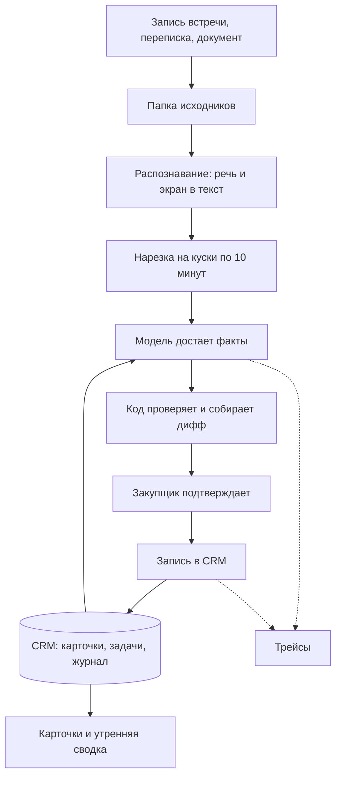
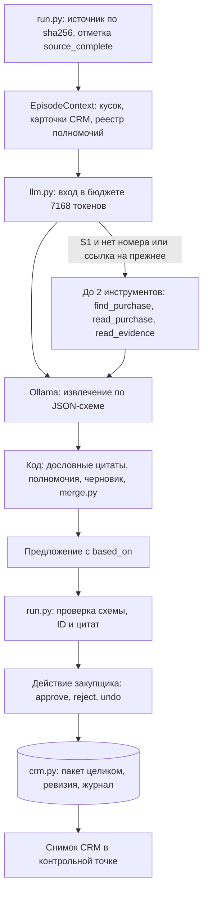

# СнабКонтур

| | |
|---|---|
| Авторы | Ефимов Павел, Лосев Никита, Фадеев Павел |
| Версия | 0.4, КТ-3 |
| Обновлен | 23.11.2026 |
| Харнесс | [`snab/`](../snab), запуск в [README](../README.md#запуск-харнесса) |
| Eval | [`eval/`](../eval/README.md), версия `2026-10-25.2` |
| Эталонный прогон | [`runs/kt3-ref`](../runs/kt3-ref): B0 на всем dev |
| ADR | [ADR-001: нужен ли модели поиск по CRM](../adr/001-search-or-fixed-pipeline.md) |

Закупщик загружает запись встречи, переписку или документы и получает дифф к карточкам закупок в CRM: изменения цен, сроков, количеств и задач. У каждой правки есть цитата из источника. После проверки закупщик подтверждает дифф, и код записывает изменения. Обработка идет локально на ноутбуке, без платных API и отправки данных наружу

Проект развивает тему 1 курса, ["Агент, пишущий в CRM по итогам встречи"](https://github.com/xufana/llm-system-engineering/blob/main/topics.md), и ее усиленную версию с долгой памятью. В исходной теме РОП (руководитель отдела продаж) ведет сделки; у нас закупщик ведет закупки, а руководитель получает сводку. Сохраняем контракт: предложения с подтверждаемой записью, без дублей и с возможностью отката

| Параметр | Решение |
|---|---|
| Пользователь | Закупщик (снабженец): ведет закупки и сам подтверждает правки, руководитель получает сводку |
| Вход | Переписка, документы, транскрипты, в итоговой версии - запись встречи со звуком и показанным экраном |
| Выход | Дифф к карточке закупки и задачам, после подтверждения - запись в CRM и утренняя сводка |
| Граница автономии | Модель только предлагает, в CRM пишет код после подтверждения человека |
| Железо | MacBook Pro M1 Pro 16 GB, локальные модели через Ollama, SQLite |
| Деньги | Без платных API. Расходы в рублях - электричество, ноутбук и время закупщика; расчет и облачные конфигурации в разделе 3 |

## 1. Контекст и пользователь

### Время и внимание на рутинную работу

В исследовании Asana переписка, поиск информации и обновление статусов занимают 58% рабочего дня ([Anatomy of Work 2022](https://resources.asana.com/rs/784-XZD-582/images/PDF-FY23-GLOBAL-EN-AOW23-GLOBAL-Anatomy-of-Work-Report.pdf)). Salesforce оценивает долю времени менеджеров на задачи вне продаж в 70% ([State of Sales 2024](https://www.salesforce.com/news/stories/sales-ai-statistics-2024/)). В опросе Microsoft 68% сотрудников говорят, что им не хватает времени на сосредоточенную работу, а 62% тратят слишком много времени на поиск информации ([Work Trend Index 2023](https://www.microsoft.com/en-us/worklab/work-trend-index/will-ai-fix-work))

В закупках операционной работы тоже много. Deloitte опросил больше 250 директоров по закупкам: даже у лучших команд около двух третей времени уходит на нестратегические задачи ([Global CPO Survey 2025](https://www.deloitte.com/content/dam/assets-zone3/us/en/docs/services/consulting/2025/us-deloitte-2025-global-cpo-survey.pdf)). В российском исследовании B2B-Center с 750+ участниками один закупщик ведет больше 10 процедур в месяц в 60% компаний; основной фокус приходится на операционные задачи ([Зрелость закупочной функции, 2025](https://b2b-rts.ru/upload/iblock/0f9/nmoft1sxlfwx7yoda3bqmjyntmi9zzbw/%D0%97%D1%80%D0%B5%D0%BB%D0%BE%D1%81%D1%82%D1%8C%20%D0%B7%D0%B0%D0%BA%D1%83%D0%BF%D0%BE%D1%87%D0%BD%D0%BE%D0%B9%20%D1%84%D1%83%D0%BD%D0%BA%D1%86%D0%B8%D0%B8_%D0%B8%D1%81%D1%81%D0%BB%D0%B5%D0%B4%D0%BE%D0%B2%D0%B0%D0%BD%D0%B8%D0%B5%20B2B-Center.pdf)). НАФИ и Яндекс 360 сообщают, что каждый третий офисный сотрудник тратит на рутину 2-4 часа в день. Среди частых задач сбор документов, переписка с контрагентами и подготовка к встречам ([CNews, 2025](https://www.cnews.ru/news/line/2025-06-18_kazhdyj_tretij_ofisnyj_sotrudnik))

Переключение между задачами расходует внимание. В исследовании Gloria Mark прерываются 57% рабочих задач; к прерванной задаче в тот же день возвращаются в среднем через 25 минут ([CHI 2005](https://ics.uci.edu/~gmark/CHI2005.pdf)). После встречи закупщик переслушивает запись, находит договоренности и переносит цены и сроки в карточку. Эту аккуратную работу по связыванию разговора с закупкой и прежними условиями передаем модели. Переговоры, выбор поставщика и ответственность за решения остаются у человека

Фиксация изменений нужна и для контроля исполнения. По 44-ФЗ изменение условий госконтракта нужно внести в реестр контрактов в течение 5 рабочих дней ([ст. 103](https://www.consultant.ru/document/cons_doc_LAW_144624/187d5d35a23a5720192d8f96419c300258202cd9/)). Британское руководство по управлению контрактами требует хранить переписку и решения встреч в одном месте и вести журнал изменений ([Cabinet Office](https://www.gov.uk/government/publications/civil-service-helping-you-with-managing-suppliers-and-contracts/contract-management-training-accreditation-foundation-level-takeaway-guide-html)). Агент готовит эти записи, закупщик проверяет их перед сохранением

### Опыт ИИ-скрайбов в медицине

ИИ-скрайб готовит черновик записи в карте по записи приема, врач проверяет его и подтверждает. По исследованию Sinsky, на карты и бумаги у врачей уходит 49% времени, на пациентов 27% ([Sinsky et al., 2016](https://adfm.org/media/1476/ann-2016-time-study.pdf)). В Permanente Medical Group скрайбы сэкономили около 15 800 часов на 2,5 млн приемов ([AMA, 2025](https://www.ama-assn.org/practice-management/digital-health/ai-scribes-save-15000-hours-and-restore-human-side-medicine)). В другом исследовании на 263 врачах выгорание за месяц снизилось с 51,9% до 38,8% ([JAMA Netw Open, 2025](https://jamanetwork.com/journals/jamanetworkopen/fullarticle/2839542))

Результат зависит от системы и времени на проверку. В рандомизированном исследовании UCLA один скрайб сократил время на запись на 9,5%, другой не дал значимой разницы. В черновиках иногда встречались клинически значимые ошибки, поэтому требовалась проверка врача ([NEJM AI, 2025](https://www.eurekalert.org/news-releases/1107474)). В нашем сравнении также учитываем время проверки черновика человеком

### Что уже есть на рынке

| Продукт | Что делает | Где работает | Чего не хватает для закупок |
|---|---|---|---|
| [Gong](https://help.gong.io/docs/ai-data-extractor), [Avoma](https://www.avoma.com/pricing), [Fireflies](https://fireflies.ai/use-cases/sales), [tl;dv](https://tldv.io/blog/tldv-honest-review/), [Otter](https://otter.ai/pricing) | Записывают звонки и встречи, заполняют поля CRM продаж | Облако, подписка от $8 до $39 за пользователя в месяц, у Gong цена не публикуется | Заточены под сделки, данные уходят в зарубежное облако, Gong и Fireflies пишут в CRM без подтверждения каждой правки |
| [HubSpot](https://knowledge.hubspot.com/meetings-tool/review-recommended-next-steps-for-deals) | Предлагает обновления полей сделки по транскрипту, пользователь их просматривает | Облако, тарифы Professional и Enterprise | Только внутри HubSpot и только продажи |
| [Битрикс24 BitrixGPT](https://helpdesk.bitrix24.ru/open/27105168/) | Расшифровывает звонки и заполняет поля CRM: пустые - без подтверждения, замену существующего значения - с подтверждением | Облако Bitrix, коробочная версия тоже обращается к их сервису, платная подписка | Звонки и сделки, а не встречи с экраном и история закупки |
| [Яндекс Телемост](https://yandex.ru/company/news/02-16-04-2025), [SaluteJazz](https://developers.sber.ru/help/jazz/guide/meeting-summarizer), [Контур.Толк](https://kontur.ru/talk/onprem) | Расшифровка и итоги встречи: темы, договоренности, задачи | Облако, у Контур.Толка есть on-premise | Протокол встречи, а не правка карточки, в CRM не пишут |
| [Тендерплан](https://www.tenderplan.ru/), [СберB2B](https://sberb2b.ru/), Контур.Закупки | Поиск тендеров, маркетплейс, CRM тендерного отдела | Облако | Про поиск закупок, а не про ведение договоренностей после встреч |

### Чем отличаемся

- Записи встреч с ценами и персональными данными остаются на ноутбуке, платных API нет. Для локальной обработки есть и правовые основания: 152-ФЗ запрещает при сборе персональных данных россиян хранить их в базах за границей ([ст. 18 ч. 5](https://www.consultant.ru/document/cons_doc_LAW_61801/cbf4e15b7c330f9372e876cdf2bc928bad7950ef/)). В 2026 году суд признал загрузку отчетов компании в DeepSeek разглашением коммерческой тайны ([BFM](https://www.bfm.ru/news/613412))
- Результат обработки сохраняется в карточке закупки. Каждая правка содержит цитату, проходит подтверждение человека и допускает откат
- Агент ведет закупку неделями, учитывая изменения и отмены условий. Он использует текущую карточку и историю предыдущих встреч

### Пользователь

Закупщик (снабженец) ведет переговоры с поставщиками, участвует во встречах, переписывается и обновляет карточки в CRM. После встречи он сам переносит договоренности в карточку и ставит задачи. Руководитель смотрит сводку сроков и поставок

Порядок работы:

1. Закупщик загружает запись встречи или выгрузку переписки
2. Через 20-45 минут видит дифф по каждой затронутой закупке
3. Сверяет с цитатами, отмечает деньги и даты, подтверждает или правит
4. Утром получает сводку: что поставляется сегодня и в ближайшие два дня, что просрочено

Пока закупка длится несколько недель, ее условия успевают измениться. Если бюджет снизили с 5 млн до 4 млн, на следующих встречах агент использует 4 млн и может показать основания как первоначального бюджета, так и его изменения

### Цель

Хотим получить продукт, который закупщик разворачивает на обычном ноутбуке и использует для подготовки карточек. Для выигрыша у ручного заполнения нужны два условия:

- проверка диффа занимает меньше времени, чем ручное заполнение карточки по той же встрече
- точность не хуже ручной: precision фактов >= 0,95 (раздел 3)

Яндекс оценивает оформление итогов одной встречи примерно в 10 минут (оценка вендора, [Яндекс, 2025](https://yandex.ru/company/news/02-16-04-2025)). В исследовании AutoMeet протоколы были у 38,5% встреч; основной причиной их отсутствия была нехватка времени. Участники также попросили ручную проверку протокола перед сохранением ([arXiv, 2025](https://arxiv.org/abs/2507.16054)). Эти данные дают отправную точку для сравнения. Собственное время заполнения и проверки измерим на наших записях, раздел 8

### Главная метрика

North-star - доля предложенных операций, которые закупщик подтвердил без правок и не откатил в течение 24 часов:

north-star = операции, подтвержденные без правки и не откаченные за 24 ч / все предложенные операции

| | |
|---|---|
| Числитель | Операции из записей `approve` журнала изменений CRM (таблица `changes`), у которых нет правки перед подтверждением (`edit_then_approve`) и нет записи `undo` в течение 24 часов |
| Знаменатель | Все операции диффов, показанных закупщику, включая отклоненные и оставленные без ответа |
| Событие в логе | Запись в `changes`: `kind` = `approve`, `edit_then_approve` или `undo`, `change_id` связывает откат с подтверждением |
| Порог | >= 80%. Это предложение команды до работы с живыми закупками, порог пересмотрим по первым данным |
| Ограничители | Recall фактов на eval >= 0,85: без него долю можно поднять осторожными диффами. Записей без подтверждения - 0 |
| Офлайн-прокси | Precision и recall диффа на dev до правок человеком, раздел 7 |
| Прокси по времени человека | Отношение медиан времени проверки диффа и ручного заполнения на странице хронометража: 0,569 на 6 кейсах dev у 3 участников, ограничения замера в разделе 8.1 |

Журнал mock-CRM хранит порядок записей, но не время. Для окна в 24 часа в журнал нужно добавить время подтверждения и отката. Остальные метрики разделов 3 и 7 - SLI под этой метрикой

## 2. Контракт

Контракт заморожен на КТ-3 (22.11.2026). Поведение ниже реализовано в харнессе [`snab/`](../snab) и проверяется кейсами eval. Изменения вносим новой записью в истории изменений

### Вход

- В первом контуре принимаем текст: выгрузки переписки TXT и JSON, готовые транскрипты, PDF с текстовым слоем, DOCX, XLSX, CSV до 20 MB. Telegram, почту и Google Sheets берем экспортом
- В итоговой версии обрабатываем также запись встречи со звуком и показанным экраном. Исходные презентации и таблицы необязательны
- Запись режем на куски по 10 минут, к каждому добавляем последние 30 секунд предыдущего, поэтому контекст модели ограничивает размер куска, а общую длину встречи ограничивает время обработки (расчет в разделе 3). Для 90 минут нужны 9 кусков; более длинные встречи проходят те же этапы за большее время
- Если цифру нельзя услышать или прочитать, оставляем ее неизвестной

### Выход

Закупщик получает дифф к карточкам и задачам. У каждой строки есть цитата и место в источнике: сообщение или минута записи. Подтверждение создает новую версию карточки и запись в журнале. Для просмотра карточки и сборки сводки модель не нужна

### Кто подтверждает и почему

Дифф подтверждает закупщик, который ведет закупку и сейчас заполняет карточку руками. Он проверяет готовые правки вместо повторного прослушивания встречи и ручного ввода. Для этого не нужен отдельный проверяющий

Модель может ошибиться даже при наличии цитат, проверок кодом и eval. Ошибка в цене или сроке стоит денег, поэтому деньги, количества, даты и реквизиты выделяем в диффе и требуем отдельной отметки. За подтвержденную запись отвечает закупщик

### Чего система не делает

Система не оформляет заказы и платежи, не пишет поставщикам и не меняет исходные файлы. Подтвержденные правки записывает в учебную mock-CRM на SQLite. Для настоящей CRM нужен адаптер с тем же контрактом

### Сущности

| Объект | Что хранит |
|---|---|
| Источник | Файл или сообщение, хэш, откуда пришло, когда было сказано и когда загружено. Если время сообщения неизвестно, дату загрузки вместо него не подставляем |
| Карточка закупки | Поставщик, позиция, количество, цена и валюта, бюджет, плановая и фактическая поставка, версия карточки |
| Задача | Что сделать, по какой закупке, кто отвечает, срок, статус |
| Дифф | Предлагаемые изменения карточек и задач с цитатами и версия карточки, от которой он посчитан |
| Журнал | Кто и когда подтвердил, отклонил или откатил дифф, значения до и после |

Плановую и фактическую поставку храним отдельно. Так устроен [OCDS](https://standard.open-contracting.org/latest/en/primer/what/), открытый стандарт публикации данных госзакупок, который используют больше 30 правительств, в том числе британский Find a Tender. У этапа исполнения есть плановая дата, фактическая дата и статус; изменение контракта сохраняется отдельной записью с причиной. Берем эту модель данных, полное применение стандарта для CRM не требуется

### Подтверждение работает как коммит в git

Закупщик видит примерно такое:

```diff
Закупка P-17 "Насосы ЦН-40", версия 4 -> 5
- Срок поставки: 10.10.2026
+ Срок поставки: 12.10.2026        встреча 03.10, 14:32 "переносим на двенадцатое"
- Цена за штуку: 12500 RUB
+ Цена за штуку: 12000 RUB         встреча 03.10, 14:35 "сходимся на двенадцати тысячах"   [отметить]
+ Задача: Анна запрашивает новый счёт до 06.10.2026      встреча 03.10, 14:37
```

Подтверждение и откат устроены по аналогии с git:

- Дифф применяется целиком или никак
- Повторная загрузка того же источника не создает новый дифф. Повторное подтверждение также оставляет состояние прежним
- Если после подготовки диффа карточка изменилась, агент пересчитывает его от новой версии, как при rebase. Устаревший дифф не применяется
- Откат создает новую версию с обратными изменениями (`git revert`). Возврат к старой версии через `reset` не используем: история сохраняется. Если затронутые поля после записи уже кто-то правил, автоматический откат останавливается и показывает конфликт

### Статусы обработки

| Статус | Когда | Что видит закупщик |
|---|---|---|
| Готово | Дифф собран, или менять нечего, или это повтор уже загруженного | Дифф на подтверждение или "изменений нет" |
| Нужно решение | Непонятно, к какой закупке относится, два противоречащих условия, "завтра" без даты сообщения | Конкретный вопрос с вариантами и цитатами |
| Ошибка | Битый файл, PDF без текста, модель не ответила за лимит, не хватило памяти, упал процесс | Причину и кнопку "повторить", источник сохранен, CRM не тронута |

Обработка работает без интернета; сеть нужна только для импорта из Telegram и почты. Не каждое неполное сообщение требует уточнения: "возможно, привезем 12-го" сохраняем как предложение, оставляя подтвержденный срок прежним. Относительную дату "завтра" считаем от времени сообщения по Москве

### Сбои и спорные случаи

| Ситуация | Что делает система | Что видит закупщик | Кейс dev |
|---|---|---|---|
| Исчерпан бюджет шагов куска: 3 вызова модели или 2 вызова инструментов | Кусок останавливается с `stop_reason=budget_exhausted`, диффа по куску нет, CRM не меняется. Вопрос `step_budget_exhausted` переходит в открытые вопросы следующего куска | "Нужно решение": по какому сообщению не хватило шагов | D-WOR-17 |
| Вход куска не помещается в 8192 токена после сокращения (раздел 6) | Модель не вызывается, `stop_reason=budget_exhausted`, вопрос `context_overflow` с оценкой размера в трейсе. Кусок нужно нарезать мельче | "Ошибка": кусок слишком большой, кнопка "повторить" | - |
| Инструмент не ответил за 2 с | Ошибка `timeout` с `retryable=true`. В том же куске повтора нет: оба вызова бюджета уже могли уйти на поиск. Итоговый вызов идет по карточкам из контекста; изменения сообщений без номера закупки не предлагаются, по ним задается вопрос `tool_timeout` с предполагаемой закупкой. Вопрос переходит в следующий кусок, и там поиск можно повторить | "Нужно решение": поиск не ответил, предполагаемая закупка и цитата | D-WOR-16 |
| Модель не ответила за 90 с или кусок занял больше 180 с | Вызов модели дольше 90 с дает `stop_reason=timeout` и вопрос `model_timeout`. Кусок дольше 180 с харнесс останавливает сам с тем же `stop_reason` и закрывает инструменты зависшего потока, следующий кусок получает новые. CRM в обоих случаях не меняется | "Ошибка", кнопка "повторить" | M01 у S1 на memory |
| Реплика с меткой `SPEAKER_xx` или без автора | Метка не дает полномочий. Если у закупки есть реестр полномочий, изменение только из таких реплик становится вопросом `unknown_speaker_authority`, а не предложением. Автор из реестра без права на поле дает `conflicting_unconfirmed_claim`. Без реестра полномочия не проверяем: деньги и даты все равно отмечает закупщик | Вопрос с цитатой и таймкодом | D-WOR-14, D-TRU-01 |
| Черновик встречи устарел относительно подтвержденной карточки | Предложение хранит `based_on` - ревизии карточек, от которых оно посчитано. Если карточку уже изменили ручной правкой, другим диффом или откатом, подтверждение возвращает `conflict`, CRM не меняется, закупщик видит `stale_revision`. Значения, предложенные раньше в этой истории, система сверяет с карточкой: поправленное или откаченное закупщиком значение в сведении не участвует | "Дифф устарел", дифф пересчитывается от новой ревизии | группа `crm` |

Метки диаризации к людям автоматически не привязываем. Сопоставлять голос с человеком по одной записи ненадежно, а ошибка дала бы чужой реплике полномочия. Закупщик видит у реплики метку и таймкод и при сомнении слушает фрагмент. Деньги и даты он отмечает в любом случае, поэтому неизвестный автор не добавляет новой проверки, а удлиняет существующую. Это время входит во время проверки диффа, которое меряем на странице хронометража (раздел 8)

## 3. Бюджеты и SLO

SLO задает числовую цель сервиса, например время обработки встречи. SLI показывает фактическое значение этой метрики ([Google SRE book](https://sre.google/sre-book/service-level-objectives/)). Бюджеты рассчитываем из доступных денег, памяти и скорости ноутбука

### Ограничения

| Ограничение | Значение | Что из него следует |
|---|---|---|
| Деньги | Без платных API | Открытые модели локально. Ноутбук, электричество и время закупщика при этом стоят денег, расчет в рублях ниже |
| Память | 16 GB общей памяти, GPU по умолчанию доступно 10,7 GB, это 2/3 ([лог llama.cpp на 16 GB Mac](https://github.com/abetlen/llama-cpp-python/issues/687)) | Модель, ее контекст и распознавание должны влезть в ~10 GB, пока закупщик работает в браузере и CRM. Модели грузим по очереди, а не все сразу |
| Скорость | Трейсы КТ-3 на `qwen3:4b-instruct-2507` ([runs/dev-llm_single](../runs/dev-llm_single), [runs/dev-agent](../runs/dev-agent)): генерация 27-31 токен/с (p50 по шагам извлечения), вызов извлечения p50 4,7-5,3 с, p95 20,7-23,3 с, максимум 34,0 с при входе до 2296 токенов. Кусок 10 минут - ~5800 токенов на входе и до ~600 на выходе (раздел 6); в eval таких входов нет, по ручному замеру КТ-1 он занимает ~51 с на 4B и ~72 с на 7-8B по оценке | Каждый лишний вызов и ретрай - секунды на кусках eval и десятки секунд на куске 10 минут |

Ручной замер КТ-1 сделан на сборке `qwen3:4b` (Thinking-2507) с `think=false`, сырых данных в репозитории нет: вызов с ~5700 токенами входа занял ~51 с в каждом из трех прогонов, Ollama показывал 3,9 GB при контексте 8192, чтение промпта ~230 токенов/с, генерация ~23 токена/с, у qwen2.5:7b - ~153 и ~17. У выбранной `qwen3:4b-instruct-2507` та же архитектура и размер, по трейсам КТ-3 она генерирует 27-31 токен/с. Скорость чтения промпта из трейсов не выделить: Ollama берет из кэша общее начало промпта, и `ttft_ms` (p50 0,7-0,8 с) отражает только непрочитанную часть. Для Qwen3-8B и T-lite-it-2.1 замера нет, их время оцениваем по qwen2.5:7b

### Сколько текста во встрече

- Темп спонтанной русской речи - около 121 слова в минуту ([исследование темпа речи](https://cyberleninka.ru/article/n/temp-rechi-v-svobodnoy-kommunikatsii-sotsiolingvisticheskiy-aspekt))
- Русский текст в токенизаторе Qwen3 - 2,35-2,76 токена на слово по оценке КТ-1. Точный подсчет на КТ-3 ([eval/history_tokens.json](../eval/history_tokens.json), `python -m eval.history_tokens`): у M01 6 095 токенов на 2 472 слова, 2,47 токена на слово и 2,9 символа на токен. В трейсах КТ-3 есть только размер всего промпта с инструкцией и JSON: фактический `prompt_eval_count` извлечения - 0,77-0,90 от оценки кода по 2,5 символа на токен, p50 0,81
- 10 минут речи - ~1200 слов, ~2900 токенов по этой оценке. Встреча 90 минут - ~11 000 слов, ~26 000 токенов

### Кусок по 10 минут и контекст

Встреча на 26 тысяч токенов технически помещается в контекст модели: у исходных Qwen3 нативно 32 768 токенов ([карточка модели](https://huggingface.co/Qwen/Qwen3-8B)), у сборок 2507 в Ollama - 256K ([теги Ollama](https://ollama.com/library/qwen3/tags)). KV-кэш Qwen3-4B занимает 144 KiB на токен: 36 слоев, 8 KV-голов по 128, f16 ([config.json](https://huggingface.co/Qwen/Qwen3-4B/raw/main/config.json)). На 32k это 4,5 GiB кэша плюс 2,5 GB весов, всего ~7 GB. У такого режима три ограничения:

- Чтение 26 тысяч токенов занимает минуту-полторы, и любой ретрай повторяет всю встречу
- На длинном контексте модели хуже находят информацию из середины ([Lost in the Middle](https://arxiv.org/abs/2307.03172)), а нам важна каждая цифра
- 8B на 32k упирается в лимит: 4,5 GiB кэша и 5,2 GB весов - ~9,7 GB из 10,7

Выбираем куски по 10 минут и к каждому добавляем последние 30 секунд предыдущего, чтобы сохранить фразу на стыке. Кусок с перекрытием - ~10,5 минуты речи, ~3000 токенов, встреча на 90 минут по-прежнему делится на 9 кусков. На вызов приходится ~6400 токенов по оценке (раздел 6), поэтому задаем контекст 8192. Кэш для 8192 занимает 1,1 GiB, с весами 4B получается ~3,6 GB по расчету, в ручном замере КТ-1 Ollama показывал 3,9 GB; остается место для распознавания и работы закупщика. В следующий кусок передаем текущую карточку и открытые вопросы из предыдущих, чтобы сохранить связь между частями встречи

При нехватке памяти можно перевести KV-кэш в q8_0 и сократить его объем вдвое ([Ollama FAQ](https://github.com/ollama/ollama/blob/main/docs/faq.mdx)). Железо на 32-64 GB позволит подавать встречу целиком и использовать модели крупнее

### Сколько обрабатывается встреча

Рассчитываем нагрузку одного закупщика на один ноутбук: его встречи и переписка. Для оценки времени берем встречу до 90 минут:

| Этап | Время на 90 минут записи | Откуда |
|---|---|---|
| Распознавание речи | ~11 минут на энкодер whisper large, декодер сверху | 3,8 с на 30 секунд аудио на CPU M1 Pro ([бенчмарк whisper.cpp](https://github.com/ggml-org/whisper.cpp/issues/89)), large-v3-turbo с 4 слоями декодера вместо 32 должен быть быстрее, замерим |
| Модель | ~8 минут на 4B, ~11 минут на 8B | 9 кусков по ~51 с (ручной замер КТ-1) и ~72 с (оценка) |
| Итого | ~19-22 минуты без декодера whisper | |

Цель для 90-минутной встречи: дифф готов за 45 минут после загрузки. Это половина длительности записи с запасом на работу закупщика за тем же ноутбуком. Часовая встреча по этой оценке - 7,6 минуты распознавания и 6 кусков по ~51 с, три такие встречи в день требуют ~38 минут фоновой обработки

### Цели качества и времени

| ID | Цель | Как меряем |
|---|---|---|
| NS | Доля операций, подтвержденных без правки и не откаченных за 24 ч, >= 80% | Журнал `changes` CRM, формула в разделе 1 |
| Q1 | Precision фактов в диффе >= 0,95, recall >= 0,85 | Против gold на eval |
| Q2 | Recall противоречий >= 0,90 | Размеченные противоречия, отдельно лишние вопросы |
| Q3 | Ни одной ошибки записи: изменения без подтверждения, дубля, половины пакета | 100% цепочек в eval |
| L1 | 95% встреч до 90 минут получают дифф за 45 минут после загрузки | По трейсам, от загрузки до готового диффа |
| L2 | 95% текстовых сообщений получают дифф за 2 минуты | По трейсам |
| L3 | Карточка открывается и дифф применяется за 1 с, p95 | Без модели |
| L4 | Утренняя сводка готова к 08:00 | Если ноутбук был выключен, собирается при включении |

Для precision задаем более высокий порог, чем для recall. Неверная цифра может уйти из CRM в заказ; пропущенное значение закупщик допишет руками

### Почему такие модели и параметры

| Требование | Откуда оно | Чем закрываем |
|---|---|---|
| Русский язык | Встречи и переписка на русском | Qwen3 обучен на 119 языках, включая русский ([блог Qwen3](https://qwenlm.github.io/blog/qwen3/)) |
| Строгий JSON | Дифф разбирает код | Ollama ограничивает ответ JSON-схемой ([structured outputs](https://docs.ollama.com/capabilities/structured-outputs)) |
| Вызов инструментов | Поиск закупки и прежних условий | У Qwen3 есть tool calling |
| Влезть в ~10 GB с контекстом 8192 | Ограничение по памяти | 4B весит 2,5 GB, 8B - 5,2 GB в Q4_K_M |
| Встреча за 45 минут | L1 | 4B быстрее 7-8B примерно в 1,4 раза: ~51 с против ~72 с на вызов по ручному замеру КТ-1 и оценке |

Модели:

- Начинаем с `qwen3:4b-instruct-2507-q4_K_M`, 2,5 GB, версии без режима рассуждений ([теги Ollama](https://ollama.com/library/qwen3/tags)). Рассуждения добавляют сотни выходных токенов, то есть десятки секунд на кусок при 27-31 токене/с. В ручном замере КТ-1 с `think=true` все 600 выходных токенов ушли на рассуждения, до ответа модель не дошла. Сборка `qwen3:4b` в режиме чата рассуждала в ответе даже с `think=false` и не дошла до вызова инструмента, поэтому нужна именно instruct-версия. На eval проверим, нужны ли они для различения договоренности и предложения
- При недостаточном качестве 4B пробуем T-lite-it-2.1, Qwen3-8B, дообученный под русский. Модель имеет лицензию Apache-2.0, занимает 5 GB и получает 83,9 на Ru Arena Hard против 57,2 у Qwen3-8B ([карточка](https://huggingface.co/t-tech/T-lite-it-2.1)). По оценке скорости обработка будет примерно в 1,4 раза медленнее
- Для кадров с таблицами, которые не прочитал OCR, используем `qwen3.5:4b`, 3,3 GB, с поддержкой изображений ([Ollama](https://ollama.com/library/qwen3.5:4b))
- Речь распознаем через whisper.cpp с large-v3-turbo. У large-v3 русский WER 5,8 на Common Voice 15 и 5,0 на FLEURS ([whisper](https://github.com/openai/whisper)). Сравним с GigaAM от Сбера: в его замере на 10 русских наборах средний WER 8,3 против 21,0 у Whisper ([GigaAM](https://github.com/salute-developers/GigaAM/blob/main/evaluation.md)). GigaAM принимает по 25 секунд аудио, поэтому требует отдельной нарезки

Параметры:

- temperature 0 и seed 42: для воспроизводимого eval ожидаем одинаковый результат извлечения на одном входе
- Контекст 8192: расчет выше, по умолчанию Ollama на машинах меньше 24 GB ставит 4096 ([docs](https://docs.ollama.com/context-length)), кусок туда не влезет
- Один запрос за раз: память под контекст умножается на число параллельных запросов ([Ollama FAQ](https://github.com/ollama/ollama/blob/main/docs/faq.mdx)), а GPU один
- Ollama ставим нативно: в Docker на маке нет GPU (тот же FAQ)

### Стоимость в рублях

Цены ниже - оценки по открытым страницам на 22.11.2026, у каждой указаны дата и ссылка. Цены облачных моделей меняются раз в несколько месяцев, перед решением их нужно проверить заново

Нагрузка: один закупщик проводит 3 часовые встречи в рабочий день. В 2026 году 247 рабочих дней и 1972 рабочих часа при 40-часовой неделе ([производственный календарь](https://www.consultant.ru/law/ref/calendar/proizvodstvennye/2026/)):

- встреч в месяц = 3 × 247 / 12 ≈ 62
- рабочих часов в месяц = 1972 / 12 ≈ 164,3
- часовая встреча при нашей нарезке - 6 кусков по 10 минут

#### Время закупщика

час закупщика = зарплата до НДФЛ × (1 + взносы) / рабочие часы в месяц ≈ 138 000 × 1,3 / 164,3 ≈ 1 090 ₽

| Параметр | Значение | Источник |
|---|---|---|
| Зарплата в Москве | 120 000 ₽ на руки, ~138 000 ₽ до НДФЛ 13% | Медиана по выборке из 408 вакансий hh.ru, зарплаты в основном на руки ([Checkroi, выборка 21.09.2026](https://checkroi.ru/blog/zarplata-menedzhera-po-zakupkam/)) |
| Нижняя оценка | 80 115 ₽, час ~630-730 ₽ | [career.hh.ru](https://career.hh.ru/profession/372?section=statistic), Москва, 2026. Страница не пишет, на руки это или до вычета |
| Взносы работодателя | 30% до 2 979 000 ₽ в год на человека | [ФНС](https://www.nalog.gov.ru/rn28/news/activities_fts/16614940/), с 01.01.2026 |

ручное заполнение в месяц = встреч в месяц × минут на встречу / 60 × час закупщика ≈ 62 × 10 / 60 × 1 090 ≈ 11 300 ₽ на закупщика

10 минут на встречу - оценка Яндекса из раздела 1. На странице хронометража медиана ручного заполнения - 35,8 с на кейс, проверки диффа - 20,4 с, отношение 0,569 ([runs/kt3-ref/timing/summary.json](../runs/kt3-ref/timing/summary.json), раздел 8.1). В кейсах от 0 до 3 операций, это не встреча, поэтому в рубли переносим только отношение. Перенос отношения с коротких кейсов на встречу - наше допущение:

проверка в месяц ≈ 0,569 × 11 300 ≈ 6 400 ₽ на закупщика

Выигрыш в месяц = ручное заполнение - проверка - стоимость обработки. Если проверка не быстрее ручного заполнения, выигрыша нет ни в одной конфигурации ниже

#### Конфигурация 1: локально на M1 Pro, текущая

стоимость = амортизация + электричество

Часы обработки в месяц: модель 62 × 6 × 51 с ≈ 5,3 ч для B1 по ручному замеру КТ-1, распознавание 62 × 7,6 мин ≈ 7,9 ч по оценке whisper.cpp из таблицы выше (3,8 с на 30 секунд аудио, 120 окон на час). Всего ≈ 13,2 ч, около 8% рабочего времени ноутбука

электричество = 13,2 ч × 0,0495 кВт × 8,90 ₽/кВт·ч ≈ 6 ₽ в месяц

- 49,5 Вт - средняя мощность от розетки под нагрузкой у MacBook Pro 14 M1 Pro в базовой версии, максимум 68,5 Вт ([Notebookcheck](https://www.notebookcheck.net/Apple-MacBook-Pro-14-2021-M1-Pro-Laptop-in-Review-How-much-Pro-do-you-get-with-the-base-model.576665.0.html)). Apple мощность под нагрузкой для этой модели не публикует ([спецификация](https://support.apple.com/en-us/111902)), наша конфигурация может отличаться от измеренной
- 8,90 ₽/кВт·ч - бытовой тариф Москвы с 01.10.2026 ([приказ ДЭПиР № ДПР-ТР-407/25](https://www.mosenergosbyt.ru/upload/docs/2026/TP-407_25.pdf)). Тариф для юрлица мы не искали; даже если он в несколько раз выше, статья остается в пределах десятков рублей

амортизация = цена ноутбука / 36 месяцев × 13,2 / 164,3 ≤ 100 000 / 36 × 0,080 ≈ 220 ₽ в месяц

100 000 ₽ - верхняя оценка цены ноутбука: по обзору iphones.ru 16-дюймовый MacBook Pro на M1 Max на вторичном рынке стоит в среднем около 100 тысяч рублей, 14-дюймовые дешевле ([iphones.ru, 2026](https://www.iphones.ru/iNotes/moy-macbook-perezhil-27-pereezdov-i-vsyo-eshchyo-letaet-kak-novyy-sovetuyu-kupit-takoy-pryamo-seychas)). Цену нашей конфигурации по объявлениям мы не собирали

Срок службы 3 года - наше допущение. Ноутбук у закупщика уже есть, поэтому в обработку относим только долю времени под нагрузкой. На кусках eval P50 эпизода S1 - 8,6 с против 4,7 с у B1, в 1,8 раза дольше ([runs/dev-agent/summary.json](../runs/dev-agent/summary.json), [runs/dev-llm_single/summary.json](../runs/dev-llm_single/summary.json)). Если отношение сохранится на кусках по 10 минут, модель S1 займет ~9,7 ч в месяц, всего с распознаванием ~17,6 ч и ≈ 8 ₽ электричества. Это оценка, кусков по 10 минут в eval нет

#### Конфигурация 2: облачная модель по API

токены на встречу = куски × токены на кусок

Токены на кусок меряем по трейсам КТ-3 на кусках eval: у B1 1 515 (вход 1 325 и выход 190 в среднем на 190 кусков, один вызов на кусок), у S1 3 204 (2 992 и 213, в среднем 1,74 вызова на кусок: 118 кусков с одним вызовом, 4 с двумя, 68 с тремя). S1 на каждом раунде поиска заново отправляет весь вход. Ollama берет его начало из кэша, а API тарифицирует все входные токены, поэтому кусок S1 стоит в 2,1 раза больше токенов, чем у B1. У выбранной B1.1 1 571 на кусок, один вызов, на 4% больше B1, поэтому оценки B1 ниже переносим на B1.1. У S1.1 3 294 (3 060 и 234, 1,75 вызова), на 3% больше S1. У S1.2 1 864 на кусок, один вызов извлечения

Кусок 10 минут длиннее куска eval. Если добавить к каждому вызову ~3000 токенов речи по оценке выше, получаем верхнюю оценку:

- B1: 6 × (1 515 + 3 000) ≈ 27 100 токенов на часовую встречу, на кусках eval 6 × 1 515 ≈ 9 100
- S1: 6 × (3 204 + 1,74 × 3 000) ≈ 50 500, на кусках eval 6 × 3 204 ≈ 19 200

стоимость в месяц = встреч в месяц × токены на встречу / 1000 × цена за 1000 токенов

| Модель | Цена за 1000 токенов | ₽ в месяц для B1 | ₽ в месяц для S1 | Источник |
|---|---|---:|---:|---|
| YandexGPT Pro 5.1 | 0,80 ₽ | 62 × 27,1 × 0,80 ≈ 1 340 | 62 × 50,5 × 0,80 ≈ 2 500 | [3DNews, 25.08.2026](https://3dnews.ru/1147409/sber-i-yandeks-v-razi-snizili-tseni-na-iitokeni-no-zarubegniy-ii-vsyo-ravno-deshevle), [ТКС, 25.08.2026](https://www.tks.ru/technology/2026/08/25/0004/rossijskie-yazyikovyie-modeli-podesheveli-do-67-procent-za-god/). Официальная страница цен не открылась, синхронный режим не подтвержден |
| YandexGPT Lite | 0,20 ₽ | ≈ 340 | ≈ 630 | Там же |
| GigaChat Pro | 0,50 ₽ с НДС | ≈ 840 | ≈ 1 570 | [Тарифы GigaChat API для юрлиц](https://developers.sber.ru/docs/ru/gigachat/tariffs/legal-tariffs), обновлено 19.11.2026 |
| GigaChat Max | 0,65 ₽ с НДС | ≈ 1 090 | ≈ 2 040 | Там же |
| GigaChat Lite | 0,065 ₽ с НДС | ≈ 110, но минимальный платеж 600 ₽ в месяц | ≈ 200, минимальный платеж тот же | Там же |

У GigaChat асинхронный режим вдвое дешевле. Ответ в реальном времени обработке встречи не нужен, поэтому для нее подходит и он

| Распознавание часовой встречи | Цена | ₽ в месяц | Источник |
|---|---|---:|---|
| SaluteSpeech | 0,60 ₽/мин | 62 × 60 × 0,60 ≈ 2 230 | [Тарифы SaluteSpeech для юрлиц](https://developers.sber.ru/docs/ru/salutespeech/tariffs/legal-tariffs), обновлено 31.08.2026. С 15.07.2026 оплата по факту закрыта для новых клиентов |
| Yandex SpeechKit, отложенное асинхронное | ~0,20 ₽/мин | ≈ 740 | Цены региона Казахстан в рублях ([SpeechKit](https://yandex.cloud/ru-kz/docs/speechkit/pricing), 05.11.2026). Страница для России не открылась, это приближение |
| Yandex SpeechKit, асинхронное | ~0,79 ₽/мин | ≈ 2 940 | Там же |

Облако снимает ограничения памяти и скорости, но записи встреч уходят с ноутбука. В них есть персональные данные, а 152-ФЗ при их сборе требует использовать базы на территории России (раздел 1). Поэтому рассматриваем только российских провайдеров

#### Конфигурация 3: арендованный GPU в Yandex DataSphere

стоимость = цена часа × часы

g1.1 с одной V100 стоит 336,96 ₽/ч, g2.1 с одной A100 - 542,88 ₽/ч с НДС ([DataSphere](https://yandex.cloud/ru/docs/datasphere/pricing), 16.10.2026; страница предупреждает, что цены в примерах могут отличаться от прайса). Если машина работает весь рабочий день, это 164,3 × 336,96 ≈ 55 400 ₽ в месяц на V100 и ≈ 89 200 ₽ на A100. Такой сервер обслуживает отдел: на N закупщиков стоимость делится на N. При оплате только за обработку стоимость = часы GPU на часовую встречу × 62 × 336,96 ₽. Часы GPU на g1.1 через vLLM мы не мерили, замер запланирован на КТ-4

#### Eval и фоновые запуски

- Утренняя сводка и пересборка саммари считаются кодом без модели, токенов не тратят
- Повтор невалидного JSON - лишний вызов модели на кусок. В прогонах КТ-3 повторов не было: 0 вызовов с `attempt=2` из 380 у S1 и из 240 у B1 (`trace.jsonl`)
- Проход dev - 452 эпизода ([runs/kt3-ref/summary.json](../runs/kt3-ref/summary.json)). B0 проходит его за 1,1 с без токенов. На 90 кейсах dev без memory B1 работал 1 456 с (24 минуты) и потратил 311 568 токенов, S1 - 1 963 с (33 минуты) и 632 486 токенов
- Стоимость прохода локально = часы прохода × 0,0495 кВт × 8,90 ₽, в облаке = токены прохода / 1000 × цена. Для S1 на 90 кейсах это ≈ 0,24 ₽ электричества и ≈ 320 ₽ по цене GigaChat Pro
- На КТ-3 запускаем B0 на dev и шумном срезе; B1, S1, S1.1, S1.2 и B1.1 на 90 кейсах dev и 7 сценариях по 3 повтора; S1, S1.1, S1.2 и B1.1 на шумном срезе; S1, S1.1 и S1.2 на 10 историях memory. Каждый прогон - одна команда `python -m snab.run` или цель Makefile (`make dev`, `make scenarios`, `make noisy`, `make memory` с `SYSTEM=...`). Прогоны B1 и S1 по очереди шли 2 ч 32 мин (22.11 с 19:22 до 21:55), S1.1 на dev и сценариях - 51 мин (с 22:08 до 22:59), S1.2 на всех четырех срезах - 2 ч 7 мин (23.11 с 09:13 до 11:21), S1.1 на шуме и memory и B1.1 - 2 ч 23 мин (23.11 с 11:39 до 14:02)
- Время команды на разметку eval и обвязку в рублях не считали. Для учебного проекта это самая крупная скрытая статья

#### Сводка в месяц на одного закупщика

| Статья | ₽ в месяц |
|---|---:|
| Ручное заполнение, 10 минут на встречу | ≈ 11 300 |
| Проверка диффа закупщиком, отношение 0,569 с хронометража | ≈ 6 400 |
| Локально: электричество, B1 / S1 | ≈ 6 / 8 |
| Локально: амортизация, верхняя оценка | ≤ 220 |
| Облако для B1: GigaChat Pro / YandexGPT Pro 5.1 | ≈ 840 / 1 340 |
| Облако для S1: GigaChat Pro / YandexGPT Pro 5.1 | ≈ 1 570 / 2 500 |
| Облачное распознавание | ≈ 740-2 940 |
| DataSphere V100 весь рабочий день, на отдел | ≈ 55 400 |

Расход на модель в любой конфигурации меньше стоимости времени закупщика. Экономику продукта определяет время проверки диффа против ручного заполнения. Локальную конфигурацию выбрали из-за данных: записи встреч не уходят с ноутбука. При малом объеме API дешевле покупки нового железа, поэтому для отдела без подходящих ноутбуков облако и DataSphere остаются вариантами

### Реализуемость на ноутбуке

По трейсам прогонов КТ-3 на 90 кейсах dev ([runs/dev-llm_single/trace.jsonl](../runs/dev-llm_single), [runs/dev-agent/trace.jsonl](../runs/dev-agent)), токены по `prompt_eval_count` и `eval_count` Ollama, перцентили по ближайшему рангу, как в `summary.json`:

| Шаг | Вызовов | Вход p50 / p95 / макс | Выход p50 / p95 / макс | Время p50 / p95 / макс, с |
|---|---:|---|---|---|
| B1, извлечение | 190 | 1 322 / 1 399 / 1 517 | 122 / 592 / 885 | 4,7 / 20,7 / 30,4 |
| S1, извлечение | 189 | 1 357 / 2 145 / 2 296 | 124 / 592 / 885 | 5,3 / 23,3 / 34,0 |
| S1, раунд поиска | 141 | 1 856 / 1 982 / 2 064 | 25 / 33 / 117 | 2,1 / 4,0 / 7,8 |
| Ответ на вопрос, B1 и S1 | 50 | 409 / 813 / 813 | 56 / 77 / 77 | 2,2-2,3 / 3,4-3,8 / 3,5-4,2 |

- Вход вызова у S1 не больше 2296 токенов, у S1.1 не больше 2329 при окне 8192, `context_overflow` на 90 кейсах нет. Выход на 90 кейсах не больше 885 токенов. 1024 - резерв под ответ в расчете окна, генерацию он не ограничивает: на историях memory выход S1 доходил до 1911 токенов
- Время куска: B1 P50 4,7 с, P95 20,7 с; S1 P50 8,6 с, P95 23,4 с, максимум 34,0 с. 68 из 190 кусков S1 потратили все 3 вызова модели, 118 обошлись одним
- Время вызова определяет генерация: 27-31 токен/с, поэтому раунд поиска с выходом в 25-33 токена стоит 2-4 с, а извлечение с длинным диффом - 20-34 с
- Куски eval короче 10 минут речи. Полное извлечение куска 10 минут - ~51 с по ручному замеру КТ-1, его нужно перемерить на записях

Ответ не стримится, закупщик получает готовый дифф, поэтому TTFT не меряем, смотрим e2e. P95 встречи нельзя получить сложением P95 кусков; 9 × P95 куска дает только верхнюю границу для 90 минут. Точное значение даст прогон на записях встреч, вместе с распознаванием

### Компромисс

Главное ограничение - данные не уходят с ноутбука. Ради него берем модель 4B и обработку за десятки минут вместо минут. Если P95 обработки встречи на записях превысит 45 минут, сначала переносим обработку в фон после рабочего дня. Следующий шаг - сервер на отдел или DataSphere. Это уже выход данных с ноутбука, такое решение оформим отдельным ADR

### Пути роста

1. Облако - модели по API, конфигурация 2 выше. Снимает ограничения по памяти и скорости, но за токены нужно платить, а данные уходят из контура
2. Свое или арендованное железо, например на грант, или GPU в DataSphere. Mac или сервер на 32-64 GB: встреча целиком в контекст, модели 8-14B, один сервер на отдел вместо ноутбука у каждого

## 4. Схема системы



| Блок | Что это на деле |
|---|---|
| Папка исходников | Папка на диске: файл хранится под своим хэшем и не меняется, поэтому цитата всегда указывает на тот же текст. В харнессе источники регистрируются по sha256, повтор с тем же текстом пропускается. `read_evidence` отбирает уже поступившие источники по номеру закупки и периоду. Полнотекстовый индекс SQLite FTS - следующая ступень лестницы из раздела 8, векторная база не используется |
| Распознавание | whisper.cpp для речи, ffmpeg достает кадры при смене экрана ([select](https://ffmpeg.org/ffmpeg-filters.html#select_002c-aselect)), OCR Tesseract читает текст с кадров, мультимодальная модель - только для сложных таблиц |
| Нарезка | Куски по 10 минут плюс последние 30 секунд предыдущего куска |
| Модель | Qwen3-4B в Ollama: получает кусок, подтвержденные карточки, черновик встречи и открытые вопросы. В S1 может до итогового ответа вызвать до двух инструментов чтения |
| Код проверяет | Схему ответа, что цитата дословно есть в поступившем источнике, полномочия автора, ревизию карточки, уникальность ID предложения. Код, а не модель, считает сумму заказа после новой цены или количества, статус `partially_delivered` при частичной приемке, валюту и единицу по словам "рублей" и "штук" рядом с числом. Для относительной даты без времени сообщения код задает вопрос `missing_source_time`. Утреннюю сводку, ответы по полям карточки и открытым задачам собирает код; к модели идут вопросы о том, кто, почему и откуда значение |
| CRM | SQLite: карточки с ревизиями, задачи, журнал изменений, отклонения и производные сводки. В харнессе своя база в памяти на каждый кейс |
| Трейсы | Запись каждого шага: что ушло в модель, что вернулось, сколько заняло. По ним разбираем ошибки и считаем SLO, подробнее в разделе 9 |

Проект не решает задачу voice identification - установления личности человека по голосу. Для разделения речи по спикерам можно использовать pyannote ([pyannote-audio](https://github.com/pyannote/pyannote-audio)), но метка вроде `SPEAKER_00` не устанавливает личность и полномочия говорящего. Если автор реплики не указан в разметке источника, система не приписывает ее конкретному человеку и не считает его полномочия известными. Извлеченные условия показываются как кандидаты изменений с цитатами и таймкодами: закупщик может прослушать соответствующий фрагмент, проверить договоренности и подтвердить или исправить дифф перед записью в CRM. Время такой проверки включаем в сравнение с ручным заполнением

### Модули харнесса

Текстовый контур реализован в [`snab/`](../snab). Распознавания, папки исходников на диске и интерфейса закупщика в нем пока нет: события приходят из кейсов eval, а действия закупщика заданы в `timeline` кейса

| Модуль | Что делает |
|---|---|
| [`snab/run.py`](../snab/run.py) | Раннер: новая CRM на кейс, эпизоды в порядке `timeline`, действия закупщика через CRM, проверка предложений кодом, файлы прогона, вызов `eval/score.py` |
| [`snab/systems/rules.py`](../snab/systems/rules.py) | B0 на регулярных выражениях, без модели |
| [`snab/systems/llm.py`](../snab/systems/llm.py) | B1 (`llm_single`) и S1 (`agent`) одним путем кода, различаются только флагом инструментов |
| [`snab/merge.py`](../snab/merge.py) | Сведение кандидатов кусков в один пакет на закупку и проверка полномочий |
| [`snab/tools.py`](../snab/tools.py) | Инструменты модели только для чтения, бюджет шагов `StepBudget`, инъекция сбоев |
| [`snab/crm.py`](../snab/crm.py) | Mock-CRM на SQLite: подтверждение пакетом, идемпотентность по `change_id`, проверка ревизии, откат, сводки |
| [`snab/contracts.py`](../snab/contracts.py) | Типы контракта: `ToolResult`, `ToolError`, `StopReason`, `EpisodeContext`, `SystemOutput` |
| [`snab/trace.py`](../snab/trace.py) | Запись шагов в `trace.jsonl` |
| [`snab/prompts/`](../snab/prompts) | Промпты `extract`, `tools`, `final`, `retry`, `answer`; их тексты и sha256 пишутся в `meta.json` |
| [`snab/report.py`](../snab/report.py) | Сводный отчет по прогонам: micro и macro, срезы, интервалы, парный бутстреп |
| [`snab/timing.py`](../snab/timing.py) | Локальная страница хронометража: ручное заполнение против проверки диффа |

### Путь одного куска



1. Раннер регистрирует новые события по sha256: повтор того же текста не обрабатывается. Последний кусок записи получает отметку `source_complete`
2. Система получает `EpisodeContext`: события куска, уже поступившие источники, снимок CRM, реестр полномочий и текущее время. Gold, инъекции сбоев и ID кейса в контекст не попадают
3. Вызов системы идет в отдельном потоке с лимитом 180 с на кусок
4. `llm.py` собирает вход: кусок, подтвержденные карточки, задачи, черновик той же встречи и до 5 открытых вопросов. Если оценка входа больше 8192 - 1024 = 7168 токенов, вход сокращается по правилу из раздела 6
5. S1 проверяет развилку: в куске нет номера закупки или есть ссылка на прежние условия. Тогда модель может вызвать до двух инструментов, иначе S1 идет как B1
6. Итоговый вызов: Ollama `/api/chat`, JSON-схема `Extraction`, temperature 0, seed 42, `num_ctx` 8192, таймаут 90 с, один повтор невалидного JSON
7. Код оставляет операции только с дословными цитатами из поступивших источников, проверяет полномочия, сводит кандидатов кусков и считает сумму заказа. Предложение по закупке появляется, когда источник завершен
8. Раннер еще раз проверяет схему предложения, уникальность ID и дословность цитат. Не прошедшее проверку предложение подтвердить нельзя; предложение с непроверенной цитатой остается в предсказаниях и считается ошибкой
9. Подтверждение закупщика вызывает `MockCrm.apply` с `change_id` и ревизиями из `based_on`: пакет пишется целиком или никак
10. В контрольных точках раннер сохраняет снимок CRM, `eval/score.py` сравнивает его с gold

Подтвержденное состояние между кусками живет в CRM. Черновик встречи, открытые вопросы и последние предложенные значения живут в памяти процесса системы (`Session` в `llm.py`) и сбрасываются при начале новой истории. В продукте черновик нужно хранить рядом с CRM, иначе перезапуск процесса посреди встречи потеряет его

### Сведение кусков одной встречи

Модель по каждому куску возвращает кандидатов: закупка, поле, значение, статус (`agreed`, `offer`, `conditional`) и цитаты. Пока запись не закончилась, кандидаты лежат в черновике и показываются следующему куску как `draft`. Когда приходит последний кусок, код сводит кандидатов по ключу (закупка, поле) в [`snab/merge.py`](../snab/merge.py):

- кандидаты упорядочены по времени сообщения, затем по таймкоду внутри записи, затем по номеру куска; позднее согласованное значение заменяет раннее
- предложение или условие никогда не заменяет согласованное значение
- цена, предоплата и сумма заказа меняются вместе: новое согласование одной из них снимает прежнюю группу, а принятие условной цены принимает и ее условие
- два разных согласованных значения в один момент - вопрос `unresolved_terms` закупщику, код между ними не выбирает
- в пакете не больше одной операции на ключ, замененные значения с цитатами сохраняются в цепочке `superseded` у победившей операции
- уже предложенные в этой истории значения участвуют в сведении, чтобы старое письмо не перезаписало более новое решение, но второй раз не предлагаются

Правило детерминировано: одинаковые кандидаты в любом порядке дают один и тот же пакет. Почему шаги задает код, а не модель, разобрано в [ADR-001](../adr/001-search-or-fixed-pipeline.md)

## 5. Харнесс и инструменты

Харнесс собирает промпт, дает модели инструменты, проверяет ответ и следит за лимитами. Этот код также записывает трейсы. Выбираем, какие шаги он выполняет сам, а какие решения передает модели

Anthropic различает workflow с заданными в коде шагами и агента, который сам выбирает следующее действие. Авторы рекомендуют начинать с самого простого работающего варианта: свободный агентный цикл дороже, медленнее и может накапливать ошибки ([статья про агентов](https://www.anthropic.com/engineering/building-effective-agents))

Берем workflow с одной развилкой:

- Код выполняет последовательные шаги: распознавание, нарезку, извлечение фактов, проверку и сборку диффа
- Модель может вызвать поиск, если в куске нет номера закупки или упоминаются прежние условия ("как договаривались в прошлый раз"). Такая привязка нужна, когда на встрече закупку называют по поставщику и товару
- Ограничиваем эту развилку вместо свободного агентного цикла. Полное извлечение куска 10 минут на 4B занимает ~51 с по ручному замеру КТ-1, поэтому длинный цикл может нарушить цель в 45 минут

В абляции обрабатываем тот же поток одним извлечением на кусок. Если поиск не улучшает результат на кейсах с привязкой и прежними условиями, убираем его. На КТ-3 поиск, которым управляет модель, дал +0,033 к успеху кейса с 95% ДИ [-0,033; +0,111] (раздел 8.1), а разбор провалов показал, что модель строит запросы из фраз вместо названий. Ступень S1.2 отдала развилку коду, но по успеху кейса проиграла S1.1 (-0,089 [-0,189; +0,000]). Абляция B1.1 - B1 на коде S1.1 без инструментов - показала, что и поиск модели на одном коде ничего не дает: S1.1 - B1.1 +0,011 [-0,056; +0,078]. Поэтому на КТ-3 поиска нет: шаги задает код, модель извлекает факты одним вызовом на кусок. Варианты, числа и условия пересмотра - в [ADR-001](../adr/001-search-or-fixed-pipeline.md)

### Запуск одной командой

B0, B1, S1.1 и S1.2 запускаются одним раннером на одном наборе и оцениваются одним `eval/score.py`:

```bash
make baseline                          # B0 на всем dev -> runs/repro/kt3-ref, сверка с runs/kt3-ref
make dev SYSTEM=llm_single             # 90 кейсов dev без memory -> runs/repro/dev-llm_single
make scenarios REPEAT=3                # 7 сценариев КТ-3 для S1.2, S1.1 и B1.1, по 3 повтора
make noisy SYSTEM=agent                # шумный срез eval/dev_noisy.jsonl
make memory SYSTEM=agent               # 10 историй memory
make report RUNS="runs/dev-agent-s11 runs/dev-llm_single-s11"
```

Системы: `rules` (B0), `llm_single` (B1.1, до исправлений S1.1 - B1), `agent` (S1.1, до исправлений - S1), `hybrid` (S1.2). Раннер сам вызывает `eval/score.py --judge off`, поэтому число без файлов прогона не появляется. Цели make пишут в `runs/repro/`: `make baseline` на итоговом коммите дает `predictions.jsonl`, побайтно равный сохраненному в `runs/kt3-ref`

### Что сохраняется с прогоном

| Файл | Содержимое |
|---|---|
| `predictions.jsonl` | Ответ системы в формате набора: предложения, вопросы, ответы, снимки CRM в контрольных точках |
| `trace.jsonl` | Одна строка на шаг: система, вызов модели, инструмент, операция CRM; поля в разделе 9 |
| `meta.json` | `git_sha`, `git_dirty`, `git_diff_sha256`, sha256 каждого файла `snab/` и `eval/score.py`, путь, `dataset_sha256_lf` и `dataset_version` набора, ID выбранных кейсов, число повторов, модель и `model_digest` из Ollama, temperature, seed, `num_ctx`, бюджет промпта, тексты и sha256 промптов, sha256 JSON-схем, бюджеты шагов, железо, версии Python и пакетов, аргументы запуска, время начала и конца |
| `summary.json` | Время прогона, P50 и P95 эпизода и кейса, вызовы модели и инструментов, ошибки инструментов по кодам, записи в CRM, токены входа и выхода, размер входа на вызов (p50, p95, максимум), `stop_reason` по счетчикам, отклоненные кодом предложения, невыполненные инъекции сбоев, пик памяти процесса, процессорное время и токены на событие, `pass_all_repeats` при повторах |
| `eval-report.json` | Отчет `eval/score.py`: метрики, группы, кейсы; при `--repeat` по файлу на повтор |

Прогоны КТ-3 сделаны поверх коммитов с незакоммиченными правками, поэтому в `meta.json` стоит `git_dirty: true`, а состав кода восстанавливается по sha256 файлов и диффа. Эталон B0 [runs/kt3-ref](../runs/kt3-ref) и прогоны S1.2 сняты на коде итогового коммита КТ-3. Стоимость в `summary.json` записана в токенах и секундах процессора; в рубли ее переводят формулы раздела 3

### Контракты инструментов

Каждый инструмент возвращает `ToolResult`: либо `data`, либо `error` с полями `code`, `retryable`, `message`, `details`. Повторяемы только `timeout` и `write_failed`. Текстовых ошибок без кода нет

| Инструмент | Сигнатура | Результат | Коды ошибок | Повтор | Таймаут и лимит |
|---|---|---|---|---|---|
| `find_purchase` | `find_purchase(query: str)` | `candidates: [{purchase_id, reason}]`: номер из текста или единственная карточка с наибольшим совпадением слов поставщика, названия, товара и объекта | `not_found`; `ambiguous` со списком кандидатов; `invalid_args`, `timeout`, `budget_exhausted` | Только `timeout`, в следующем куске | 2 с; общий лимит 2 вызова инструментов на кусок |
| `read_purchase` | `read_purchase(purchase_id: str)` | `card`, `revision`, `tasks` | `not_found`, `invalid_args`, `timeout`, `budget_exhausted` | Только `timeout` | То же |
| `read_evidence` | `read_evidence(purchase_id: str, period: {from, to} \| None)` | `fragments: [{event_id, quote}]` из уже поступивших источников с номером закупки | `not_found`, `invalid_args`, `timeout`, `budget_exhausted` | Только `timeout` | То же |
| Модель, `/api/chat` | Сообщения и JSON-схема `Extraction` или `QueryAnswer` | `changes` и `issues` или ответ на вопрос | `timeout`, `invalid_output`, `budget_exhausted` | Один повтор невалидного JSON | 90 с на вызов, 3 вызова на кусок |
| `MockCrm.apply` | `apply(operations, change_id, expected_revision, proposal_id, kind)` | `applied` с новыми ревизиями; повтор того же `change_id` - `already_applied` без второй записи | `conflict` при другой ревизии; `write_failed` - транзакция откатилась целиком; `not_found`, `invalid_args` | `write_failed` - тем же `change_id` | Только по действию закупщика, модель не вызывает |
| `MockCrm.undo` | `undo(change_id, undo_change_id)` | `undone` новой ревизией или `already_undone` | `conflict`, если поля правили позже; `not_found` | Нет | Только по действию закупщика |
| `MockCrm.reject` | `reject(proposal_id, reason)` | `rejected`, карточки не меняются | - | - | Только по действию закупщика |
| `MockCrm.rebuild_summary` | `rebuild_summary(purchase_id)` | `rebuilt`: сводка по текущей ревизии с цитатами из журнала | `not_found` | Нет | Код, без модели |

Инструменты модели доступны только для чтения. Подтверждение и откат запускает закупщик кнопками в интерфейсе, изменения записывает код. Неизвестное имя инструмента или пропущенный аргумент в ответе модели дают `invalid_args`, а не исключение. JSON-схема ограничивает форму ответа; правильность значений отдельно проверяем кодом и на eval

### Бюджет шагов и остановка

Счетчики бюджета принадлежат харнессу (`ModelTools` в `snab/tools.py`): модель не может их обойти, каждый вызов модели и инструмента списывается до запроса. Каждая остановка получает `stop_reason`

| `stop_reason` | Когда | Что делает система | Статус для закупщика |
|---|---|---|---|
| `done` | Дифф собран или менять нечего | Предложения по завершенным источникам | "Готово" |
| `clarify` | Есть вопросы закупщику | Предложения по остальному и вопросы | "Нужно решение" |
| `budget_exhausted` | Исчерпаны вызовы модели или инструментов, или вход не помещается в окно | Диффа по куску нет, вопрос `step_budget_exhausted` или `context_overflow`, CRM не тронута | "Нужно решение" |
| `timeout` | Модель не ответила за 90 с или кусок дольше 180 с | Диффа по куску нет, зависший поток получает закрытые инструменты | "Ошибка" |
| `tool_error` | Инструмент вернул `timeout` | Итоговый вызов по карточкам, изменения сообщений без номера закупки задержаны как вопрос `tool_timeout` | "Нужно решение" |
| `invalid_output` | JSON невалиден после повтора, система бросила исключение или ни одно предложение не прошло проверку кодом | Диффа по куску нет | "Ошибка" |

Харнесс считает время и токены вместе с качеством: время каждого шага и эпизода, вызовы, токены из `prompt_eval_count` и `eval_count` Ollama, ошибки инструментов, пик памяти, процессорное время. Сводка по ним попадает в `summary.json`, разбивка по срезам - в отчет `snab/report.py`

### Инъекция сбоев и отложенная часть

Кейс может задать `input.fault_injections`: точку (`at`), операцию (`find_purchase`, `read_purchase`, `read_evidence` или `commit`), сбой (`timeout`, `step_budget_exhausted`, сбой записи после первой операции пакета) и `once`. Система этих данных не видит и получает обычную типизированную ошибку. Если система не дошла до операции со сбоем, кейс отмечается как `unsupported` и в успех не входит: так B0 получил `unsupported` на D-WOR-17, потому что не вызывает `read_evidence`

`--split test` без флага `--i-know-this-is-heldout` раннер не запускает, страница хронометража test не открывает. Test откроем на КТ-4, сейчас записан только его sha256 (раздел 7)

### Лимиты считаем из бюджета времени

На обработку 90 минут записи из 9 кусков отводим 45 минут. Распознавание занимает по оценке ~11 минут (раздел 3), для модели остается ~34 минуты, или ~3,8 минуты на кусок. Лимит куска берем 3 минуты, с запасом на декодер whisper. Лимиты на кусок:

- До 3 вызовов модели: извлечение и до 2 раундов поиска
- До 2 вызовов инструментов, таймаут инструмента 2 с: инструменты читают SQLite в памяти и отвечают за миллисекунды
- 1 повтор, если вернулся невалидный JSON
- Таймаут вызова 90 с, почти вдвое больше полного извлечения куска 10 минут (~51 с) и в 2,6 раза больше самого долгого вызова на 90 кейсах dev (34,0 с). На сценариях и шумном срезе вызов доходил до 43,8 с, на историях memory у S1.2 до 59,6 с, а один вызов S1 на M01 уперся в таймаут 90 с. Дальше считаем вызов зависшим
- 180 с на кусок целиком: ~3 минуты из бюджета выше, после них харнесс останавливает систему

Эти значения записаны в `StepBudget` в [`snab/tools.py`](../snab/tools.py) и попадают в `meta.json` каждого прогона

Цепочку S1 меряем по трейсам [runs/dev-agent](../runs/dev-agent) (таблица в разделе 3). Раунд поиска занимает p50 2,1 с, p95 4,0 с, максимум 7,8 с: начало диалога Ollama берет из кэша (`ttft_ms` раунда p50 1,3 с, p95 3,1 с), а вызов инструмента - 25 выходных токенов в p50 и 33 в p95. Извлечение после поиска - p50 5,3 с, p95 23,3 с. Кусок S1 целиком - P50 8,6 с, P95 23,4 с, максимум 34,0 с

Худший случай куска 10 минут оцениваем из этих частей: извлечение ~51 с по ручному замеру КТ-1, два раунда поиска по 7,8 с и один повтор невалидного JSON на 885 токенов при 27 токенах/с, ~33 с. Всего ~100 с при лимите 180 с. Модель тратит на встречу до ~15 минут, вместе с распознаванием ~26 минут из 45

Повтор ответа при закэшированном промпте стоит только генерацию: 592-885 токенов (p95 и максимум выхода извлечения) при 27-31 токене/с - ~19-33 с на кусок, то есть ~3-5 минут на встречу за каждый лишний круг, и задерживает следующие встречи в очереди. В прогонах КТ-3 повторов не было. При исчерпании лимита кусок получает `stop_reason=budget_exhausted` и статус "нужно решение". Источник и CRM сохраняются, обработка остальных кусков продолжается

### Многошаговые сценарии

Сценарии КТ-3 перечислены в [`eval/scenarios_kt3.txt`](../eval/scenarios_kt3.txt), по одному на обязательный тип. Это истории группы `workflow` из dev с gold-состояниями CRM после каждого действия. `make scenarios` гоняет их по 3 раза для S1.2, S1.1 и B1.1, B1 и S1 прогнаны так же до исправлений S1.1. При temperature 0 и фиксированном seed три повтора проверяют остаточный недетерминизм, а не разброс выборки

| Обязательный тип | Кейс | Что должно произойти |
|---|---|---|
| Второй шаг зависит от первого | D-WOR-01 "Насосы: скидка после решения финансов" | Скидка попадает в дифф только после решения финансов, подтверждение пишет пакет |
| Ошибка инструмента посередине | D-WOR-16 "Ремни: отказ от поиска, затем ответ" | `find_purchase` на шаге 3 отвечает `timeout`; изменение без номера закупки становится вопросом `tool_timeout`, записи нет; следующий шаг дает ответ |
| Упор в бюджет шагов | D-WOR-17 "Сальники: лимит поиска" | `read_evidence` на шаге 3 исчерпывает бюджет; `stop_reason=budget_exhausted`, вопрос `step_budget_exhausted`, записи нет |
| Противоречие и смена вводных | D-WOR-04 "Фильтры: старое письмо после нового" | Старое письмо, загруженное позже, не перезаписывает новое решение |
| Повтор | D-WOR-07 "Датчики: повтор не вторая поставка" | Повторная загрузка не дает второй поставки и второй записи |
| Отмена | D-WOR-06 "Муфты: исправление и отмена" | Откат создает новую ревизию с прежними значениями |
| Полномочия и неизвестный голос | D-WOR-14 "Редукторы: неизвестный голос" | Реплика `SPEAKER_xx` вне реестра дает вопрос `unknown_speaker_authority`, а не изменение |

| Кейс | B0, 1 прогон | B1, успех в 3 повторах | S1, успех в 3 повторах | S1, `stop_reason` и записи в CRM на повтор | S1.1 | S1.2 | B1.1 |
|---|---|---|---|---|---|---|---|
| D-WOR-01 | провал | 3/3 | 3/3 | `done` 5, `approve` 1 | 3/3 | 3/3 | 3/3 |
| D-WOR-16 | провал | 0/3, `unsupported`: B1 не вызывает `find_purchase` | 3/3 | `done` 4, `tool_error` 1 (`timeout` у `find_purchase`), `approve` 1 | 3/3 | 3/3 | 0/3, `unsupported` |
| D-WOR-17 | провал, `unsupported`: B0 не вызывает `read_evidence` | 0/3, `unsupported` | 3/3 | `done` 4, `budget_exhausted` 1, `approve` 1 | 0/3 | 3/3 | 0/3, `unsupported` |
| D-WOR-04 | провал | 0/3 | 3/3 | `done` 5, `approve` 1 | 3/3 | 3/3 | 3/3 |
| D-WOR-07 | провал | 0/3 | 0/3 | `done` 5, `approve` 1 | 3/3 | 3/3 | 3/3 |
| D-WOR-06 | провал | 3/3 | 3/3 | `done` 5, `approve` 1, `undo` 1 | 3/3 | 3/3 | 3/3 |
| D-WOR-14 | провал | 0/3 | 3/3 | `done` 4, `clarify` 1, `approve` 1 | 3/3 | 3/3 | 0/3 |

Источники: `runs/scenarios-llm_single`, `runs/scenarios-agent`, `runs/scenarios-agent-s11`, `runs/scenarios-hybrid` и `runs/scenarios-llm_single-s11`, поле `pass_all_repeats` в `summary.json`; `stop_reason` и операции CRM - по `trace.jsonl`, `stop_reason` только по кускам, без шага ответа на вопрос. B0 не прошел ни одного сценария из семи ([runs/kt3-ref](../runs/kt3-ref)): вопросов закупщику правила не задают, а на всей группе `workflow` у B0 верны 3 цепочки состояний CRM из 25. B1 прошел 2 сценария из 7, S1 - 6 из 7. Все три повтора дали одинаковый результат по каждому кейсу у всех пяти систем, остаточного недетерминизма на этих сценариях не видно. D-WOR-07 S1 проваливает во всех повторах: частичная приемка приходит без статуса `partially_delivered`, разбор в разделе 8.2. S1.1 выводит статус кодом и проходит D-WOR-07, но проваливает D-WOR-17 во всех повторах: на шаге 3 модель не стала читать историю закупки, подложенный сбой бюджета не сработал, и вопроса `step_budget_exhausted` нет. S1.2 проходит все 7 сценариев во всех повторах: чтение истории на ссылку "из старого письма" вызывает код. Выбранная B1.1 ([runs/scenarios-llm_single-s11](../runs/scenarios-llm_single-s11)) проходит 4 из 7: D-WOR-16 и D-WOR-17 по построению `unsupported`, инструментов у нее нет, а D-WOR-14 провален во всех повторах. На шаге 4 там сообщение без номера закупки "Посмотрела решение финансов: лимит 400000 рублей", и без поиска B1.1 не привязала лимит к P-D714. Инструменты с контрактами, бюджет шагов и инъекции сбоев остаются в харнессе: обязательные сценарии с ошибкой инструмента и упором в бюджет проходят S1.1 и S1.2 на том же раннере. Почему на КТ-3 выбрана система без инструментов и что вернет поиск - в ADR-001 Записей без подтверждения нет: каждая запись в CRM - `approve` или `undo` из `timeline` кейса

## 6. Память и состояние

Текущее подтвержденное состояние хранится в CRM, основания остаются в исходниках и журнале изменений. Производные данные можно пересобрать:

| Тип | Что | Где в продукте | Где в харнессе | Как меняется | Срок жизни |
|---|---|---|---|---|---|
| Рабочее | Кусок, вход вызова, черновик встречи, открытые вопросы | Память процесса | `EpisodeContext`; `Session.drafts`, `Session.open_questions` (до 5) в `llm.py` | Вход собирается заново на каждый кусок, черновик закрывается с концом источника | Вход - один вызов, черновик - до конца встречи, сессия - до новой истории |
| Эпизодическое | Исходники и журнал изменений: что сказали, написали и что подтвердили | Папка исходников, таблица `changes` в SQLite | Источники раннера по sha256, `ModelTools.sources`, `changes` в `crm.py` | Только дописывается, откат сохраняется новой записью | Все время закупки |
| Фактическое | Карточки и задачи с ревизиями, реестр полномочий | SQLite | `purchases`, `tasks` в `crm.py`; `authority_registry` из кейса | Только через `apply` и `undo`: подтвержденный дифф, ручная правка, откат | Пока закупка открыта |
| Кэш | Сводки и саммари, значения, уже предложенные в этой истории, кэш промпта Ollama, кэш распознавания | SQLite и файлы | `derived_views` с `based_on_revision`, `Session.committed` | Сводка сбрасывается при записи в карточку и пересобирается кодом; предложенные значения сверяются с карточкой | До изменения карточки |

Между запросами состояние живет в CRM и исходниках, модель ничего не помнит. Рабочее состояние встречи живет в процессе системы, в продукте его нужно хранить рядом с CRM (раздел 4)

### Что попадает в контекст

| Часть | Токенов |
|---|---:|
| Инструкция и JSON-схема | ~1000 |
| Текущая карточка закупки | ~500 |
| Открытые вопросы из прошлых кусков | ~300 |
| Кусок встречи, 10 минут и 30 секунд перекрытия | ~3000 |
| Найденные цитаты | до ~1000 |
| Ответ | до ~600, бюджет 1024 |
| Итого | ~6400 из 8192, из них ~5800 на вход |

Таблица - оценка для куска 10 минут до реализации. Замер в прогонах КТ-3 на кусках eval, которые короче 10 минут речи, по `prompt_eval_count` и `eval_count` Ollama ([runs/dev-agent/summary.json](../runs/dev-agent/summary.json), `trace.jsonl`):

- вход вызова S1: p50 1821, p95 2134, максимум 2296; у B1 p50 1315, p95 1381, максимум 1517
- выход извлечения: p50 124, p95 592, максимум 885, то есть оценка ~600 верна для p95. Резерв 1024 покрывает максимум на 90 кейсах, но на историях memory выход доходил до 1911, а `num_predict` в вызове не задан; ограничение генерации добавим на КТ-4

По частям вход не размечается: в трейсе каждого вызова есть оценка размера, показанные и пропущенные карточки и число убранных цитат

Карточки передаются компактно: только поля, без ревизий и служебных данных. У событий остаются ID, автор или метка спикера, время, таймкод и текст

Бюджет входа - 8192 - 1024 = 7168 токенов, 1024 оставлены на ответ. До вызова размер оцениваем по длине текста, 2,5 символа на токен с запасом для кириллицы в JSON. Если оценка больше бюджета, код сокращает вход в таком порядке:

1. Текст открытых вопросов прошлых кусков, затем цитаты черновика, от старых к новым
2. Карточки закупок, которых нет в куске, черновике и открытых вопросах, начиная с наименее похожих на кусок по словам. Их номера остаются в `omitted_purchase_ids`, и S1 может прочитать такую карточку через `read_purchase`
3. Карточки из куска, черновика и открытых вопросов не убираются, кусок не обрезается

Если вход и после этого больше бюджета, модель не вызывается: кусок останавливается с `context_overflow` (раздел 2). Ollama при переполнении молча обрезал бы начало промпта вместе с инструкцией, поэтому остановка лучше такого вызова. У S1 результаты инструментов растят вход итогового вызова, его размер проверяется еще раз после поиска

Пять закупок в одной истории - кейс D-WOR-25 "Двигатели: перенос двух объектов". Пять карточек с задачами вместе с куском могут не поместиться в 8192. Тогда первыми уходят карточки закупок, которых нет в куске, а две закупки из куска остаются. Замер в [runs/dev-agent/trace.jsonl](../runs/dev-agent): пять карточек поместились целиком, `cards_omitted` пуст во всех 11 вызовах, `prompt_eval_count` от 569 у ответа на вопрос до 2283 у извлечения после поиска. Сокращение входа на dev пока не срабатывало

Историю закупки целиком не передаем: она растет по мере поступления источников. Используем текущую карточку, черновик встречи и `read_evidence` по номеру закупки и периоду. В полном eval по две истории на выборку имеют проверенную нижнюю границу больше 8192 токенов Qwen3, в dev это D-MEM-01 и D-MEM-02. На них проверяем, что вход вызова остается в окне, хотя история в него не помещается. На 10 историях memory у S1 ([runs/dev-agent-memory](../runs/dev-agent-memory)) максимальный `prompt_eval_count` - 2563, а `context_overflow` сработал 2 раза: D-MEM-01 и D-MEM-02, по одному эпизоду с оценкой входа ~26 000 токенов. Оба эпизода остановились с `budget_exhausted` без записи в CRM, как задано в разделе 2. Еще один эпизод M01 остановился с `timeout`: вызов модели не ответил за 90 с, CRM не менялась. Успех историй memory у S1 - 0 из 10, diff recall micro 0,41 (63/153), у B0 0,29 (44/153). SQLite FTS с фильтрами по поставщику и дате и эмбеддинги - ступени лестницы из раздела 8

### Противоречия, свежесть, отравление

Модель различает предложение, договоренность, исправление и отмену; закупщик принимает решение через дифф. Самого появления нового сообщения для изменения карточки недостаточно. Учитываем время сообщения: старое письмо, загруженное позже, не перезаписывает более новое решение. Прежнее значение сохраняется в журнале

Правило сведения из раздела 4: побеждает более позднее согласованное значение по времени сообщения, таймкоду и номеру куска, предложение не заменяет договоренность, два разных согласованных значения в один момент дают вопрос закупщику. След остается в двух местах: проигравшие значения с цитатами лежат в `superseded` у операции, прежнее значение карточки - в журнале `changes`

У каждого поля журнал хранит цитаты последнего действующего изменения (`field_evidence` в `crm.py`), по ним видно источник и время сообщения. Сводка хранит ревизию карточки, от которой собрана (`based_on_revision`). После записи в карточку сводка сбрасывается, система сообщает `derived_view_needs_rebuild`, и устаревшая сводка не используется как факт. Времени подтверждения в журнале mock-CRM пока нет, его добавим вместе с окном north-star (раздел 1)

Команда "игнорируй инструкции" в письме поставщика остается частью источника и не выполняется. Сведения становятся фактами CRM после подтверждения диффа. Ошибку исправляем новой версией карточки и пересборкой саммари. Правдоподобную ложь без опровержения в источниках система не распознает; ее должен заметить закупщик при подтверждении

Тесты на отравление в dev:

- E16 и PZ02 - инструкция в документе и в письме поставщика пытается изменить карточку или память
- PZ01 - неподтвержденное число в пересланной переписке
- PZ03 и D-TRU-04 - устаревшее саммари и рабочий кандидат не становятся фактом
- PZ04 - исправление ошибочно подтвержденного факта и производной сводки

Неверный факт вычищается откатом его изменения (`undo`) или ручной правкой новой ревизией, затем сводка пересобирается `rebuild_summary`. Ни одна система не прошла тесты на отравление E16, PZ01-PZ04 и D-TRU-04: у B0, B1, S1, S1.1 и S1.2 по 0 из 6. На группе `trust` B0 прошел 0 из 10, B1 и S1 по 1, S1.1 и S1.2 по 2. В PZ02 и D-WOR-15 S1 предложил бюджет из внедренной инструкции, а код его не отсеял: цитата дословная, но значение из нее не следует. Разбор в разделе 8.2. Метрики памяти на дашборде (рост объема, попадания поиска, срабатывания сокращения входа) - на КТ-4

## 7. Eval

Полный текстовый набор содержит [100 dev](../eval/dev.jsonl) и [100 test](../eval/test.jsonl). В каждой выборке по 25 многошаговых сценариев и 10 длинных историй; остальные 65 объектов проверяют извлечение, договоренности, привязку к закупкам, доверие к источникам, запись и сводки. Состав, форматы, методика и ограничения описаны в [eval/README.md](../eval/README.md), все сюжеты - в [индексе](../eval/index.md)

Размер набора выбран для проверки основных сценариев и дорогих ошибок в пределах учебного проекта. В каждой выборке 15 кейсов проверяют извлечение данных и еще 15 - различение предложений, договоренностей и конфликтов: эти ошибки напрямую влияют на правильность цены, количества и срока. На привязку к закупке, доверие к источникам и операции CRM выделено по 10 кейсов, чтобы проверить разные причины отказа: неоднозначность товара, неизвестного автора, отсутствие полномочий, повтор, откат и изменение ревизии. Пять кейсов сводки покрывают границы временного окна и разные состояния задач

Больше всего примеров выделено многошаговым сценариям: 25 workflow и 10 memory на выборку. Отдельное извлечение не показывает, сохранит ли система правильное состояние после пересогласования, отмены, повторной загрузки или ручной правки. Поэтому проверяем как последовательности действий, так и длинные истории с отвлекающими обсуждениями и изменениями условий. Число сообщений и вопросов внутри истории не считаем числом независимых кейсов

Dev и test имеют одинаковое распределение классов, чтобы сравнение не зависело от разного состава выборок. При этом отличаются сюжеты, участники, товары, значения и формулировки источников. Предусмотрены разговорная речь, оговорки, неполные сведения, несколько закупок и условия, которые меняются по ходу встречи. Такой объем покрывает разные ошибки, но не дает статистической гарантии качества на реальных закупках

| Проверка | Что оцениваем |
|---|---|
| Извлечение и договоренности | Precision/recall фактов до правок человеком, условные предложения, изменения между кусками и нерешенные конфликты |
| Привязка и доверие | Товар и поставщик без номера, несколько закупок, неизвестный спикер, отсутствие полномочий, инструкции в источнике |
| Запись и исполнение | Подтверждение, повтор, откат, ручная правка, устаревшая ревизия, сбой транзакции, таймаут и лимит шагов |
| Сводка | Границы окна, просрочка, выполненные и отмененные задачи, отсутствие срока |
| Память | Актуальные условия, частичные поставки, смена владельца задачи, поздние письма, исторические вопросы |

Метрики следуют из обещаний системы. Контракт требует предложить изменения конкретной карточки и задач, поэтому precision и recall считаем по закупке, полю и значению; ошибочная привязка к другой закупке считается неверным фактом. Требование показывать основание каждой правки проверяем долей фактов с дословной и подтверждающей цитатой. Для случаев, где договоренность не установлена и требуется решение закупщика, считаем recall конфликтов, лишние уточнения и необоснованные изменения

Требования записывать изменения только после подтверждения, применять пакет целиком, не создавать дублей и безопасно выполнять откат проверяем по состояниям CRM после каждого действия. Отдельно проверяем ревизии и сохранность более поздних правок. Проверки формата и арифметики нужны, чтобы к записи уходили корректные данные: структурированный результат должен разбираться кодом, а суммы, количества и остатки - соответствовать исходным условиям

Обещание учитывать действующие условия закупки проверяем ответами по истории и отсутствием отмененных или опровергнутых значений среди текущих. Обещание собирать утреннюю сводку проверяем precision и recall ее пунктов: просроченных действий, ближайших дедлайнов и ожидаемых поставок. Соблюдение временного окна и исключение выполненных и отмененных задач проверяем отдельно. Время обработки относится к SLO из раздела 3 и измеряется при запуске системы; текстовый eval сам по себе не подтверждает скорость обработки аудио или качество распознавания

У каждого объекта есть исходное состояние, события, действия, gold-предложения с цитатами и контрольные состояния CRM. Разбиение выполнено по целым сюжетам, все прежние 26 объектов находятся в dev. Test не используется для настройки, хотя лежит в репозитории

В каждой выборке два новых сюжета больше контекста 8192. Точный подсчет токенизатором Qwen3 на КТ-3 ([eval/history_tokens.json](../eval/history_tokens.json)): D-MEM-01 23 077, D-MEM-02 23 695, T-MEM-01 25 108, T-MEM-02 26 311 токенов, остальные истории memory от 3 091 до 6 095. Оставшиеся истории проверяют длительное ведение закупки. Прогоны систем на dev описаны в разделе 8.1

Текущий набор полностью текстовый. Аудио/видео и парные прогоны по записи и ручной расшифровке остаются отдельной работой: ASR/OCR этим набором не оцениваются

### Версия набора

| Файл | Версия | sha256 без учета CRLF |
|---|---|---|
| [eval/dev.jsonl](../eval/dev.jsonl) | `2026-10-25.2` | `f34bae11cfc2667a7ba3c10e4f33a75b3f0c0032627cf88dc7fbcb984e5eb90b` |
| [eval/test.jsonl](../eval/test.jsonl) | `2026-10-25.2` | `688ad3a57d63cce19db894150f88c0c18f8d82a57d448ef8b35a83b2d9b199f1` |
| [eval/dev_noisy.jsonl](../eval/dev_noisy.jsonl) | `2026-10-25.2-noisy.1` | `2f411cfbfa55253d5d77aaa4fce77292fe9f26d7d567d6c85ca751402f220065` |

Хэш считается так же, как в `snab/run.py` и `eval/annotations/compare.py`: sha256 байтов файла после замены CRLF на LF. Раннер пишет его в `meta.json` каждого прогона как `dataset_sha256_lf`, поэтому прогон на измененном наборе отличим от прогона на замороженном. Хэш test записан сейчас, сам test откроем на КТ-4

### Пункт контракта, метрика и кейсы

Знаменатели - из прогона B0 на dev ([runs/kt3-ref/eval-report.json](../runs/kt3-ref/eval-report.json)) там, где они задаются gold, а не ответом системы

| Пункт контракта | Метрика | Знаменатель на dev | Где кейсы |
|---|---|---|---|
| Кейс выполнен целиком: все структурные проверки сошлись | Успех кейса (`fully_matches_structured_gold`), главная офлайн-метрика | 100 кейсов | Все группы |
| Дифф к нужной карточке: закупка, поле, значение | `diff_precision`, `diff_recall`, micro и macro | 269 фактов gold в 72 кейсах | Все группы, кроме `summary` |
| У каждой правки цитата | `literal_citations`; `supported_citations` с судьей | Предложения системы | Все группы с фактами |
| Неясное - вопрос закупщику, а не догадка | `conflict_recall`, лишние вопросы | 13 противоречий | `decisions`, `trust`, `crm`, `workflow`, `memory`; меньше 20 |
| Привязка к закупке без номера | `purchase_link_accuracy` | Предложения системы | `entities`, 10 кейсов; меньше 20 |
| Полномочия, неизвестный автор, инструкции в источнике | Успех кейса | 10 кейсов | `trust`; меньше 20 |
| Запись только после подтверждения, пакетом, без дублей, с откатом | `crm_checkpoints`, `crm_chains` | 779 контрольных точек, 100 цепочек | `crm` 10, `workflow` 25 и все кейсы с действиями |
| Суммы и количества сходятся | `calculation_accuracy`, `arithmetic_consistency` | Проверки снимков CRM | Все группы с ценой и количеством |
| Ответ разбирается кодом | `format_validity`, `case_schema_validity` | Ответы системы | Все группы |
| Действующие условия по истории | `answers_accuracy` | 151 контрольный вопрос | `memory` 10, `workflow` 25 |
| Утренняя сводка | `summary_precision`, `summary_recall`, `summary_window_accuracy` | 22 пункта сводки | `summary`, 5 кейсов; меньше 20 |
| Нечего менять - нет диффа | `no_change_case_accuracy` | 28 кейсов | Разные группы |

На группе меньше 20 кейсов интервал Вилсона шире примерно ±15 п.п., поэтому решения по такой группе отдельно не принимаем, только по объединенным срезам. Отчет помечает такие строки

### Как считаем оценку

Действия `query` в eval используются для проверки сохраненных условий и их оснований. Это контрольные запросы тестового сценария, отдельный диалоговый интерфейс в первом контуре для них не нужен. Вопросы внутри исходной переписки остаются частью источника и сами по себе не запускают такой запрос

Оценку выполняет `eval/score.py`: он принимает эталон и результаты системы в одинаковом формате JSONL и сопоставляет кейсы по ID. Факты диффа оцениваются до исправлений закупщиком, состояния CRM - после каждого контрольного действия. Точные значения, расчеты, ревизии и привязку к закупкам проверяем кодом; формат входов, снимков и ответов судьи - строгими Pydantic-моделями

LLM-судья через LangChain и OpenAI-совместимый API сопоставляет по смыслу разные формулировки задач, конфликтов и оснований фактов. Совпадения с эталонной разметкой не требуют вызова модели. Судья возвращает структурированный вердикт, а TP, FP, FN и итоговые метрики считает код. Ошибки судьи отмечаются как незавершенные проверки и не засчитываются как успех

Отчет содержит результаты по кейсам, группам и всей выборке, включая пропуски и причины ошибок. Сравнение снимков CRM проверяет представленные состояния, но без журнала исполнения не доказывает реальное выполнение транзакций. Формат файлов, метрики и порядок запуска описаны в [инструкции оценщика](../eval/SCORING.md)

На КТ-3 раннер вызывает оценщик с `--judge off`. Проверки, которым нужен судья, остаются незавершенными, и метрики с ними даны нижней границей. Судью и его проверку на людях подключим на КТ-4; судья будет из другого семейства моделей, чем Qwen, чтобы не оценивать собственные ответы

### Отчет: micro, macro и срезы

`python -m snab.report runs/<a> runs/<b> --out runs/REPORT.md` сводит прогоны в одну таблицу ([`snab/report.py`](../snab/report.py)):

- micro precision и recall - сумма числителей на сумму знаменателей по всем фактам. Длинная история с 35 фактами весит в нем больше короткого кейса с одним
- macro - среднее значение по кейсам, где метрика определена, с числом таких кейсов. Расхождение micro и macro показывает, что результат держится на нескольких длинных историях
- срезы: каждая группа, короткие кейсы против историй `workflow` и `memory`, все кейсы и каждая история `memory` отдельно
- успех кейса и цепочки CRM - с интервалом Вилсона 95%
- сравнение с базовым прогоном - парный бутстреп по кейсам, 2000 выборок, seed 42
- кейсы, где расхождений нет, но основания ждут судью, в успех не входят и показаны отдельным столбцом

### Шумный срез

[eval/dev_noisy.jsonl](../eval/dev_noisy.jsonl) - 15 шумных вариантов кейсов dev: строчные буквы без пунктуации, слова-паразиты, числа словами, метки `SPEAKER_xx` вместо имен, опечатки в названии поставщика, размытый хвост реплики. Gold совпадает с родителем, кроме цитат, а в `origin.gold_note` записано, почему он остался верным. Срез оставлен в dev, в метрики основного dev не входит и сравнивается с теми же 15 родителями ([eval/README.md](../eval/README.md)). Результаты - в разделе 8

### Эталонные ответы и согласие разметок

Ожидаемый дифф и состояние CRM заданы вручную в `gold` каждого кейса. На подвыборке из 36 кейсов (18 dev и 18 test) сопоставлены [human1.json](../eval/annotations/human1.json) и [human2.json](../eval/annotations/human2.json)

Согласие до арбитража считаем как `F1 = 2 * matched / (A + B)`, где A и B - количество нормализованных единиц в каждой разметке, matched - число совпавших единиц с учетом повторов

| Единицы сравнения | A | B | Совпало | F1 |
|---|---:|---:|---:|---:|
| Факты предложенных изменений и атрибуты задач | 194 | 194 | 193 | 0,994845 (99,48%) |
| Проблемы: шаг, код и закупка | 13 | 13 | 10 | 0,769231 (76,92%) |
| Структурированные элементы ответов на вопросы | 251 | 251 | 251 | 1,000000 (100%) |

Для фактов учитываем шаг, закупку, поле и значение. Локальные ID задач сопоставляем через закупку, действие и объект; нормализуем регистр, пробелы, ё/е и десятичную запись чисел. Цитаты и свободные объяснения в это сравнение содержания не входят. Поэтому 100% по ответам означает совпадение структурированных значений, а не полное совпадение текстов или отдельную оценку качества цитат. У 14 кейсов обе разметки не предлагают фактов: их F1 равен N/A, они не увеличивают среднее согласие

Это согласие двух разметок на подвыборке, по курсу оно же потолок метрики. Качество агента оно не показывает. Несколько фактов одной истории зависимы; общие ошибки разметок возможны. Сравнение можно повторить командой `python eval/annotations/compare.py`

## 8. Baseline и план усложнений

В основном baseline закупщик заполняет карточку и задачи по той же записи встречи. Для отправной точки используем открытые исследования: около 10 минут на оформление итогов по оценке Яндекса и протоколы у 38,5% встреч по AutoMeet (раздел 1). В рандомизированном исследовании UCLA один из двух скрайбов сократил время на запись на 9,5%, второй не дал значимой разницы. Учитываем это при сравнении: для системы измеряем время проверки диффа, для ручного варианта время заполнения. Каждый из нас прошел 6 кейсов dev на странице хронометража [`snab/timing.py`](../snab/timing.py): E10, E14, D-WOR-01, D-EXT-07, D-DEC-01 и E12, в них от 0 до 3 операций. Результаты и ограничения замера в разделе 8.1

При ручном заполнении участник получает запись встречи, исходную карточку и задачи, но не видит предложения агента и gold. Он самостоятельно находит договоренности и переносит их в CRM. Использует чек-лист: цена, валюта, количество, условия оплаты, сроки поставки и поручения с исполнителями и сроками. Измеряем время просмотра записи, заполнения и проверки карточки

Для сравнения агент обрабатывает ту же запись и предлагает готовые изменения. Участник проверяет их по цитатам и таймкодам, исправляет ошибки, добавляет пропущенные сведения и подтверждает запись в CRM. Измеряем время человека на проверку, уточнения и исправления. Время обработки записи агентом считаем отдельно. Итоговые карточки и задачи в обоих случаях сравниваем с gold, чтобы оценить не только скорость, но и правильность заполнения. Повторное знакомство участника с записью может ускорить работу, поэтому порядок прохождения вариантов фиксируем и учитываем при разборе результатов

Автоматический baseline построен на регулярных выражениях и фиксированных правилах: извлекает номера закупок, даты, суммы, количества и создает шаблонные задачи. Номер вида `P-17` связывает сообщение с закупкой; конструкции "20 штук" и "по 12 500 рублей" задают количество, цену и валюту. Явные даты приводятся к единому формату, относительные вычисляются только при известной дате источника. Из "Анна, запроси счет до 6 октября" формируется задача с действием, исполнителем и сроком. Каждое предложение сопровождается цитатой. Условные формулировки вроде "возможно" и "если" не становятся безусловными изменениями; неоднозначная закупка или противоречащие значения требуют уточнения. Подтверждение и запись работают по тому же контракту, что и у агента

При необходимости отдельно проверим небольшие BERT-модели, дообученные на размеченных примерах для выделения сущностей и классификации фраз: договоренность, предложение или отмена. Это дополнительный вариант baseline; скорость дообучения и качество проверим экспериментально. Для обучения используем только обучающую часть данных, отложенные истории оставляем для оценки

Baseline и агент получают одинаковые текстовые входы и исходное состояние CRM. Правила и параметры моделей фиксируем до отложенного прогона. Сравниваем precision и recall предложенных изменений до исправлений человеком, обнаружение противоречий и время обработки. Прогон на ручной расшифровке показывает вклад модели в извлечение без влияния ошибок распознавания речи

### 8.1 Измерения на dev

Обозначения: B0 - правила без модели, B1 - одно извлечение моделью на кусок без инструментов (абляция S1), S1 - то же извлечение с ограниченной развилкой поиска, которую ведет модель. S1.1 - S1 с исправлениями кода и промпта `extract` по разбору провалов, S1.2 - гибрид: развилку ведет код, модель без инструментов. B1.1 - абляция S1.1: B1 на коде S1.1 без инструментов, 0,49 (44/90) [0,39; 0,59], diff P/R micro 0,77* / 0,81* ([runs/dev-llm_single-s11](../runs/dev-llm_single-s11)). Что меняет каждая ступень, описано в разделе 8.2. Все ступени живут в [`snab/systems/llm.py`](../snab/systems/llm.py): B1, S1.1 и S1.2 выбираются флагом `--system llm_single|agent|hybrid`, а S1 - та же `agent` до исправлений S1.1. B1 и S1 сняты поверх коммита с тегом `kt3-s1`, S1.1 - поверх `kt3-s11`, оба с незакоммиченными правками. B1.1, S1.2 и S1.1 на шуме и memory сняты поверх 458246f с правками, которые вошли в итоговый коммит; от `kt3-s11` они отличаются расширением цитат до предложения в hybrid и переносом карт сбоев инструментов в `snab/tools.py`, путь `llm_single` и `agent` тот же; точный код каждого прогона - `code_sha256` в его `meta.json`. Текущая `--system agent` - это S1.1, `--system llm_single` - B1 с исправлениями кода S1.1. Все запускаются одним раннером на `eval/dev.jsonl` версии `2026-10-25.2` и оцениваются `eval/score.py --judge off`. Модель - `qwen3:4b-instruct-2507-q4_K_M`, temperature 0, seed 42, `num_ctx` 8192. Звездочка - часть проверок ждет судью, значение - нижняя граница

Сравнение на 90 кейсах dev без группы memory, список ID - [`eval/ids_dev_nonmemory.txt`](../eval/ids_dev_nonmemory.txt). B0 на тех же 90 кейсах пересчитан прогоном [runs/dev-rules](../runs/dev-rules) (`make dev SYSTEM=rules`): метрики качества совпали со срезом эталонного прогона [runs/kt3-ref](../runs/kt3-ref), время и вызовы B0 в таблице из этого пересчета. Сводка - `python -m snab.report runs/dev-llm_single runs/dev-agent`, для ступеней S1.1 и S1.2 - `python -m snab.report runs/dev-agent runs/dev-agent-s11` и `python -m snab.report runs/dev-agent-s11 runs/dev-hybrid`

| Метрика | B0 | B1 | S1 | S1.1 | S1.2 |
|---|---|---|---|---|---|
| Успех кейса, 95% ДИ | 0,17 (15/90) [0,10; 0,26] | 0,32 (29/90) [0,24; 0,42] | 0,36 (32/90) [0,26; 0,46] | 0,50 (45/90) [0,40; 0,60] | 0,41 (37/90) [0,32; 0,51] |
| Diff precision, micro | 0,85* (66/78) | 0,74 (73/98) | 0,76 (78/102) | 0,82* (93/113) | 0,87* (93/107) |
| Diff recall, micro | 0,57* (66/116) | 0,63 (73/116) | 0,67 (78/116) | 0,80* (93/116) | 0,80* (93/116) |
| Diff precision / recall, macro | 0,77 (n=48) / 0,57 (n=62) | 0,73 (n=57) / 0,62 (n=62) | 0,76 (n=58) / 0,70 (n=62) | 0,78 (n=59) / 0,78 (n=62) | 0,86 (n=59) / 0,81 (n=62) |
| Conflict recall | 0,11 (1/9) | 0,33 (3/9) | 0,33 (3/9) | 0,33 (3/9) | 0,44 (4/9) |
| Цепочки CRM, 95% ДИ | 0,63 (57/90) [0,53; 0,73] | 0,64 (58/90) [0,54; 0,74] | 0,68 (61/90) [0,58; 0,77] | 0,78 (70/90) [0,68; 0,85] | 0,78 (70/90) [0,68; 0,85] |
| Без расхождений, но ждут судью | 24 | 3 | 3 | 5 | 14 |
| Записей без подтверждения | 0 по построению: CRM пишет только раннер по действию закупщика | 0 по построению | 0 по построению | 0 по построению | 0 по построению |
| Вызовы модели / инструментов | 0 / 38 | 240 / 0 | 380 / 134 | 343 / 134 | 200 / 31, инструменты вызывает код |
| Токены вход / выход | 0 | 273 060 / 38 508 | 589 734 / 42 752 | 585 116 / 44 692 | 330 223 / 27 846 |
| Эпизод P50 / P95 | 0,2 / 0,3 мс; на всем dev 0,2 / 0,5 мс | 4,7 / 20,7 с | 8,6 / 23,4 с | 8,8 / 31,7 с | 4,8 / 14,8 с |
| Кейс P50 / P95 | 0,8 / 2,2 мс | 9,4 / 39,3 с | 13,3 / 59,0 с | 12,5 / 57,7 с | 8,1 / 32,3 с |
| Время прохода | 0,4 с | 1 456 с | 1 963 с | 1 980 с | 1 119 с |
| `stop_reason`, вместе с ответами на вопросы | `done` 239, `tool_error` 1 | `done` 217, `clarify` 23 | `done` 229, `clarify` 9, `tool_error` 1, `budget_exhausted` 1 | `done` 231, `clarify` 8, `tool_error` 1 | `done` 225, `clarify` 13, `tool_error` 1, `budget_exhausted` 1 |

Успех кейса по группам, число прошедших кейсов:

| Группа | Кейсы | B0 | B1 | S1 | S1.1 | S1.2 |
|---|---:|---:|---:|---:|---|---|
| `extraction` | 15 | 2 | 2 | 1 | 6 | 2 |
| `decisions` | 15 | 5 | 9 | 9 | 8 | 7 |
| `entities` | 10 | 2 | 5 | 5 | 4 | 6 |
| `trust` | 10 | 0 | 1 | 1 | 2 | 2 |
| `crm` | 10 | 1 | 3 | 5 | 6 | 4 |
| `summary` | 5 | 5 | 0 | 0 | 5 | 5 |
| `workflow` | 25 | 0 | 9 | 11 | 14 | 11 |
| Короткие кейсы | 65 | 15 | 20 | 21 | 31 | 26 |

Группы меньше 20 кейсов показаны для разбора, решений по ним отдельно не принимаем (раздел 7)

Разница по успеху кейса, парный бутстреп по 90 кейсам, 2000 выборок, seed 42:

| Сравнение | Все 90 кейсов | `workflow` | Короткие кейсы |
|---|---|---|---|
| B1 - B0 | +0,156 [+0,022; +0,278] | +0,360 [+0,160; +0,560] | +0,077 [-0,077; +0,231] |
| S1 - B0 | +0,189 [+0,067; +0,311] | +0,440 [+0,240; +0,640] | +0,092 [-0,062; +0,246] |
| S1 - B1 | +0,033 [-0,033; +0,111] | +0,080 [-0,120; +0,280] | +0,015 [-0,046; +0,077] |
| S1.1 - S1 | +0,144 [+0,056; +0,233] | +0,120 [-0,040; +0,280] | +0,154 [+0,062; +0,262] |
| S1.1 - B1 | +0,178 [+0,078; +0,289] | +0,200 [-0,040; +0,440] | +0,169 [+0,046; +0,292] |
| B1.1 - B1, исправления кода | +0,167 [+0,078; +0,267] | +0,080 [-0,080; +0,280] | +0,200 [+0,108; +0,308] |
| S1.1 - B1.1, один код извлечения | +0,011 [-0,056; +0,078] | +0,120 [-0,040; +0,280] | -0,031 [-0,092; +0,031] |
| S1.2 - S1.1 | -0,089 [-0,189; +0,000] | -0,120 [-0,280; +0,040] | -0,077 [-0,185; +0,031] |
| S1.2 - B1 | +0,089 [-0,022; +0,211] | +0,080 [-0,160; +0,320] | +0,092 [-0,031; +0,215] |

S1.1 - S1: +0,144 [+0,056; +0,233], интервал выше нуля. Исправлены 16 кейсов, среди них все 5 `summary` и 5 из `extraction`, регрессий 3: D-DEC-02 ждет судью, D-ENT-05 и D-WOR-17 провалены. S1.2 - S1.1: -0,089 [-0,189; +0,000]. S1.2 исправила 5 кейсов (E18, D-DEC-03, D-ENT-03, D-ENT-05, D-WOR-17) и потеряла 13, из них 9 ждут судью. В этих 9 значения совпали с gold, а цитата по границам отличается от размеченной: длиннее, короче или с лишней цитатой соседнего предложения. Без судьи оценщик такую цитату не засчитывает, поэтому 0,41 у S1.2 - нижняя граница. Провалены по-настоящему E13, D-ENT-08, D-WOR-10 и D-WOR-13

Модель дает прирост над правилами на историях `workflow`, но проигрывает им на `summary` (0 из 5 против 5 из 5) и на извлечении: diff recall группы `extraction` у S1 0,56 (23/41) против 0,88 (36/41) у B0. Потеря на `summary` - ошибка кода, S1.1 ее закрыла (5 из 5). На `extraction` S1.1 проходит 6 кейсов из 15 против 2 у B0, но diff recall у нее 0,80* (33/41) против 0,88 (36/41) у B0 и precision 0,87* (33/38) против 1,00 (36/36). Извлечение фактов правила на коротких кейсах пока делают лучше модели. Разбор в разделе 8.2

Поиск S1 против B1 исправил 7 кейсов: D-DEC-05, D-CRM-02, D-CRM-03, D-WOR-04, D-WOR-14, D-WOR-16, D-WOR-17. В D-WOR-16 и D-WOR-17 сбой назначен на инструмент, и B1 их не проходит по построению (`unsupported`). Новых провалов 4: D-EXT-02, D-WOR-18, D-WOR-21 и D-DEC-08, который ждет судью. На `entities` разница 0: обе системы прошли 5 кейсов из 10. Условие ступени 2 не выполнено: 95% ДИ S1 - B1 включает ноль, а исправления идут вместе с новыми провалами

B0 на всем dev, 100 кейсов ([runs/kt3-ref](../runs/kt3-ref)):

| Срез | Кейсы | Успех кейса, 95% ДИ | Diff P micro | Diff R micro | Цепочки CRM |
|---|---:|---|---|---|---|
| Все кейсы | 100 | 0,15 (15/100) [0,09; 0,23] | 0,65* (110/169) | 0,41* (110/269) | 0,57 (57/100) |
| Короткие кейсы | 65 | 0,23 (15/65) [0,15; 0,35] | 0,86* (62/72) | 0,85* (62/73) | 0,83 (54/65) |
| Истории `workflow` и `memory` | 35 | 0 (0/35) [0; 0,10] | 0,49 (48/97) | 0,24 (48/196) | 0,09 (3/35) |
| `memory` | 10 | 0 (0/10) | 0,48 (44/91) | 0,29 (44/153) | 0 (0/10) |

Остальные метрики B0 на всем dev: macro precision 0,72 (n=58), macro recall 0,52 (n=72), conflict recall 0,08 (1/13), контрольные точки CRM 0,33 (260/779), дословные цитаты 1,00 (169/169), привязка к закупке 0,66 (112/169), ответы на вопросы 0,35 (53/151), утренняя сводка 1,00 по precision и recall (22/22). Весь проход - 1,1 с на 452 эпизода, 78 записей в CRM, эпизод P50 0,2 мс, P95 0,5 мс

Micro recall B0 на всем dev ниже macro: 0,41 против 0,52. Длинные истории дают 196 из 269 фактов, и правила теряют на них больше всего. На коротких кейсах recall фактов B0 - 0,85*, на уровне цели Q1, precision - 0,86* при цели 0,95. Успех кейса при этом 0,23: вопросов закупщику B0 не задает и находит 1 противоречие из 13. Различение договоренности и обсуждения и ведение истории закупки правилами не закрываются, для них и нужна модель

На 10 историях memory S1 ([runs/dev-agent-memory](../runs/dev-agent-memory)) не прошел ни одной, как и B0: diff P micro 0,50 (63/127), R micro 0,41 (63/153), цепочки CRM 0 из 10. S1.2 ([runs/dev-hybrid-memory](../runs/dev-hybrid-memory)) тоже 0 из 10: P micro 0,63 (62/99), R micro 0,41 (62/153), 9 эпизодов остановлены с `budget_exhausted`. S1.1 ([runs/dev-agent-s11-memory](../runs/dev-agent-s11-memory)) - тоже 0 из 10: P micro 0,51 (74/144), R micro 0,48 (74/153), 6 эпизодов с `timeout`, 2 с `invalid_output` и 2 с `budget_exhausted`. Длинные истории не решает ни одна ступень КТ-3. Diff recall по историям:

| История | Фактов | S1 | S1.1 | S1.2 |
|---|---:|---|---|---|
| D-MEM-01 | 12 | 5 | 5 | 4 |
| D-MEM-02 | 12 | 5 | 7 | 3 |
| D-MEM-03 | 16 | 9 | 8 | 8 |
| D-MEM-04 | 13 | 7 | 6 | 6 |
| D-MEM-05 | 14 | 7 | 9 | 6 |
| D-MEM-06 | 13 | 4 | 11 | 4 |
| D-MEM-07 | 12 | 5 | 4 | 4 |
| D-MEM-08 | 14 | 3 | 3 | 2 |
| D-MEM-09 | 12 | 5 | 4 | 4 |
| M01 | 35 | 13 | 17 | 21 |

Разброс по историям большой: у S1.1 от 3 из 14 (D-MEM-08) до 11 из 13 (D-MEM-06). На M01, где больше всего фактов, S1.2 находит больше всех, 21 из 35, а на остальных не больше других: строго меньше на D-MEM-01, D-MEM-02, D-MEM-05 и D-MEM-08. B1.1 на memory не запускали, это план КТ-4

Шумный срез против тех же 15 родителей из dev, прогоны `runs/noisy-*` (`make noisy SYSTEM=...`), родители - срез прогонов на 90 кейсах:

| | Успех кейса | Diff P micro | Diff R micro |
|---|---|---|---|
| B0, родители | 0,20 (3/15) | 0,76 (13/17) | 0,59 (13/22) |
| B0, шум | 0,20 (3/15) | 0,63 (5/8) | 0,23 (5/22) |
| S1, родители | 0,47 (7/15) | 0,65 (15/23) | 0,68 (15/22) |
| S1, шум | 0,40 (6/15) | 0,65 (15/23) | 0,68 (15/22) |
| S1.1, родители | 0,53 (8/15) | 0,77* (17/22) | 0,77* (17/22) |
| S1.1, шум | 0,47 (7/15) | 0,77* (17/22) | 0,77* (17/22) |
| S1.2, родители | 0,60 (9/15) | 0,84* (16/19) | 0,73* (16/22) |
| S1.2, шум | 0,27 (4/15) | 0,79* (15/19) | 0,68* (15/22) |
| B1.1, родители | 0,47 (7/15) | 0,73* (16/22) | 0,73* (16/22) |
| B1.1, шум | 0,40 (6/15) | 0,76* (16/21) | 0,73* (16/22) |

В шумных вариантах числа написаны словами, текст идет строчными буквами, в названиях есть опечатки. Правила на них теряют больше половины найденных фактов: 5 из 22 против 13 из 22. S1 и S1.1 на шуме теряют по одному кейсу (D-DEC-01) и ни одного факта, B1.1 - один кейс (D-WOR-01) и ни одного факта. S1.2 теряет 5 кейсов из 9 (E09, E10, D-DEC-01, D-TRU-01, D-WOR-02) и 1 факт. Вероятная причина - подсказки правил B0: на шуме правила находят 5 фактов из 22 вместо 13. По трейсам это пока не проверяли. Срез маленький, решений по нему отдельно не принимаем

#### Хронометраж человека

Ручной baseline на странице хронометража: участник выбирает группу A или B, группы получают противоположные режимы на одних кейсах. Время считается по меткам браузера без пауз, правильность сервер считает по gold и участнику не показывает. Отношение медиан проверки и ручного заполнения считается только при балансе: обе группы есть, и каждый кейс пройден в обоих режимах

Замер 22.11.2026: 3 участника, 18 записей, по 9 в каждом режиме, в группе A 2 человека, в группе B 1 ([runs/kt3-ref/timing/summary.json](../runs/kt3-ref/timing/summary.json), записи по участникам в `runs/kt3-ref/timing/*.jsonl`)

| | Медиана на кейс | Среднее | Precision / recall | Записи, совпавшие с gold |
|---|---|---|---|---|
| Ручное заполнение | 35,8 с | 44,3 с | 0,50 (13/26) / 0,87 (13/15) | 2 из 9 |
| Проверка диффа B0 | 20,4 с | 29,6 с | 0,94 (15/16) / 1,00 (15/15) | 8 из 9 |
| Проверка / ручное | 0,569 | | | |

Прокси north-star по времени человека - 0,569: проверка готового диффа заняла 57% времени ручного заполнения, а precision итоговой карточки выросла с 0,50 до 0,94. По кейсам проверка быстрее на E10, E14, D-WOR-01 и D-EXT-07, медленнее на D-DEC-01 и E12. Из 13 лишних операций ручного режима 8 - поля со значением null, еще 4 - значения в D-DEC-01, где по gold менять нечего. Ошибка это участника или формы страницы, не разбирали

Ограничения замера:

- 3 участника - авторы системы и eval, проходили замер вместе, в одном коворкинге
- 6 коротких кейсов от 0 до 3 операций, это не встреча на 90 минут
- В режиме проверки страница показывала дифф B0 из `runs/kt3-ref/predictions.jsonl`, а не S1. На D-WOR-01 и D-DEC-01 дифф B0 пуст: на D-WOR-01 участник проверки сам вносил все три операции, на D-DEC-01 по gold менять нечего
- Внутри одного человека режимы приходятся на разные кейсы, а сложность кейсов разная. Контрбаланс только между группами, и группы неравные: 2 человека против 1

Перед решением о продукте замер нужно повторить с диффом выбранной ступени B1.1 и на записях встреч, это план КТ-4

### 8.2 Разбор провалов и план усложнений

Начинаем с модели 4B без поиска. На этом этапе используем готовые текстовые расшифровки, как предусмотрено первым контуром проекта. Модель получает очередной кусок встречи, относящиеся к нему карточки закупок и накопленный черновик предыдущих кусков. После обработки всей встречи код собирает итоговый дифф. На dev-наборе проверяем precision фактов не ниже 0,95, recall не ниже 0,85 и recall противоречий не ниже 0,90. Запись без подтверждения, дубли и частичное применение пакетов недопустимы

Перед усложнением разбираем причины ошибок и слой, где их чинить: код, промпт, модель или gold. Если нужные сведения есть в контексте, но модель неправильно понимает договоренность, проверяем инструкции и размер модели. Если ей не хватает прежнего решения или она неверно определяет закупку, проверяем поиск и сборку контекста. Если ошибка детерминирована, ее закрывает код, а не модель

#### Разбор провалов S1

S1 провалил 58 из 90 кейсов. Провалы разобрали по `trace.jsonl` и `eval-report.json` прогона [runs/dev-agent](../runs/dev-agent). У кейса бывает несколько причин, поэтому сумма по классам больше 58

| Класс | Кейсов | Слой | Примеры | Где чиним |
|---|---:|---|---|---|
| Задача стала полями карточки: `create_task` недостижим в JSON-схеме | 10 | код | E01, E04, D-WOR-10 | S1.1 |
| Смысловые вопросы не заданы: инъекция, мало оснований | 9 | промпт | PZ02, D-TRU-03, D-EXT-08 | КТ-4 |
| Нет единицы и валюты рядом с числом | 7 | код | E19, D-EXT-01 | S1.1 |
| Неверный формат ответа на вопрос | 7 | код | E20, D-WOR-10 | S1.1: ответы по карточке собирает код |
| Утренняя сводка отвечена моделью вместо кода | 5 | код | D-SUM-01...05 | S1.1 |
| Код принял от модели неизвестное поле или статус | 5 | код | E01, E05, E14 | S1.1: статус выводит код |
| Значение не следует из цитаты | 5 | код | PZ02, D-WOR-15, E13 | S1.1 проверяет цитаты, S1.2 сверяет числа с текстом |
| Поиск сбил привязку: запрос из фразы, `not_found`, пустой дифф | 5 | код | D-WOR-03, D-EXT-02, D-CRM-05 | S1.2 |
| Детерминированный вопрос не задан: нет валюты, нет времени сообщения, два значения в одном кандидате | 5 | код | E07, E13, D-DEC-03 | S1.1 частично |
| Лишний или неполный вопрос о привязке | 5 | код | E18, D-ENT-06 | КТ-4 |
| Неверное поле или статус договоренности | 4 | промпт | D-EXT-03, D-WOR-20 | КТ-4 |
| Вопрос к gold | 4 | gold | PZ01, PZ03, PZ04, E20 | КТ-4 |
| Карточка найдена, модель ничего не вернула | 3 | модель | D-WOR-23, D-WOR-13, E16 | ступень 4 |
| Повторное предложение значения, которое закупщик уже внес вручную | 3 | харнесс | D-CRM-01, D-CRM-04, D-WOR-18 | КТ-4 |
| Частичная приемка без статуса | 2 | код | D-WOR-07, D-WOR-08 | S1.1 |
| Не та закупка: запрос взят из карточки, а не из текста | 1 | промпт | D-ENT-03 | S1.2 |
| Полномочия проверены по любой цитате кандидата | 1 | код | D-TRU-01 | S1.1: проверка по цитатам, где есть значение |
| Пакет посчитан не от той ревизии | 1 | код | D-WOR-25 | КТ-4 |
| Бюджет шагов и остановка | 0 | харнесс | - | - |

Больше половины классов - ошибки кода вокруг модели, а не понимания текста. Модельный слой - 3 кейса. Поэтому следующие ступени чинят код и отдают коду развилку, а не меняют модель. Полные разборы трех провалов по полям трейса - задача КТ-4, ниже их краткая версия

D-SUM-01, утренняя сводка. Вопрос "Что у меня на сегодня и ближайшие два дня? Просрочку тоже покажи." ушел в модель с промптом `answer`, который разрешает только плоские поля карточки. В трейсе шаг `kind=llm`, `name=answer` с `tokens_in` 813 там, где модели быть не должно, а в `output` - поля карточки вместо окна сводки, просроченных и ближайших задач. Оценщик дает 0 из 5 по пунктам сводки, то же во всех пяти кейсах `summary`. B0 проходит их через `crm.morning_summary`, в LLM-системе такой ветки не было. Слой - код, раздел 4 и так требует собирать сводку без модели

E01, задача превратилась в поля карточки. На "Анна, запроси счёт у Дельты до 6 октября 2026 года" извлечение (`tokens_in` 1269) вернуло `set_field` с полями `title`, `owner` и `due_date` у P-17 и ни одного `create_task`, а код принял неизвестные поля и подтверждение записало их в карточку. Причина в схеме: Ollama строит грамматику ответа с ключами по алфавиту, каждая операция начиналась с ключа `evidence`, и после него вариант `CreateTask`, у которого первый ключ `due_date`, становился недостижим. За весь прогон 0 операций с задачами из 251, это 12 потерянных фактов gold в 10 кейсах. Слой - код: схема, а не модель

D-WOR-07, частичная приемка. Сообщение "Приняли 4 штуки, это первая часть заказа." без номера закупки открыло развилку, `find_purchase` нашел P-D707, `read_purchase` показал 10 заказанных и 0 принятых. Итоговое извлечение (`tokens_in` 2127) вернуло только `delivered_quantity` 4, а gold ждет еще статус `partially_delivered`. Правило о статусе было в промпте, но здесь модель его не применила, а в E05, E12 и D-EXT-07 применила к сообщениям о задачах. Сценарий проваливается во всех трех повторах. Слой - код: статус следует из количества, его должен выводить код

#### Лестница

| # | Ступень | Что меняет и почему | Условие перехода или решения | Статус |
|---|---|---|---|---|
| 0 | B0: правила, [runs/kt3-ref](../runs/kt3-ref), все 100 dev | Нижняя граница без модели | Измерен: успех кейса 0,15 на dev, 0 на историях, 0 вопросов закупщику | Готово |
| 1 | B1: одно извлечение 4B на кусок, [runs/dev-llm_single](../runs/dev-llm_single), 90 dev | Договоренность против обсуждения, условия, задачи | К ступени 2, если B1 ниже Q1 и не меньше 20% провалов B1 - не та закупка или нет прежней договоренности. B1 ниже Q1: P 0,74, R 0,63 | Готово: 0,32 против 0,17 у B0, +0,156 [+0,022; +0,278] |
| 2 | S1: развилка поиска, которую ведет модель, до 2 инструментов чтения, [runs/dev-agent](../runs/dev-agent), 90 dev | Привязка без номера, прежние условия | Оставляем, если 95% ДИ S1 - B1 по успеху кейса выше нуля или S1 исправляет хотя бы один проваленный кейс без новых провалов; P95 куска не больше 180 с | Измерен: +0,033 [-0,033; +0,111], 7 исправлений и 4 новых провала, P95 куска 23,4 с. Условие не выполнено, разбор провалов выше |
| 2.1 | S1.1: S1 и исправления кода по разбору. Сводка и ответы по полям карточки собирает код, задачи достижимы в схеме ответа, статус, единицу и валюту выводит код, цитата должна содержать значение, полномочия проверяются по этим цитатам, `runs/dev-agent-s11` | Классы слоя "код" из разбора, кроме привязки | Переходим к 2.2, если S1.1 - S1 по успеху кейса не ниже нуля и не появилось новых провалов на `summary` и `extraction`. S1.1 - S1: +0,144 [+0,056; +0,233], `summary` 5 из 5 вместо 0, `extraction` 6 из 15 вместо 1. Регрессии: D-DEC-02 ждет судью, D-ENT-05 и D-WOR-17 провалены | Готово: 0,50 (45/90) [0,40; 0,60], условие выполнено |
| 2.2 | S1.2, гибрид: поиск закупки и прежних условий маршрутизирует код, кандидаты правил B0 идут модели подсказками, числа сверяются с текстом, у модели нет вызовов инструментов, `runs/dev-hybrid` | Поиск сбивает привязку: модель строит запрос из фразы и находит не ту карточку | Оставляем, если S1.2 - S1.1 по успеху кейса не ниже нуля, на `entities` и `workflow` нет новых провалов, 7 сценариев проходят во всех 3 повторах не хуже S1 и P95 куска не больше 180 с. S1.2 - S1.1: -0,089 [-0,189; +0,000], `workflow` 11 из 25 против 14, `entities` 6 из 10 против 4; сценарии 7 из 7, P95 эпизода 14,8 с | Измерен, условие не выполнено. 14 кейсов ждут судью, пересмотр на КТ-4 |
| 2.3 | B1.1, абляция S1.1: B1 на коде S1.1, без инструментов, [runs/dev-llm_single-s11](../runs/dev-llm_single-s11) | Нужен ли поиск модели, если вычесть исправления кода | Поиск оставляем, если 95% ДИ S1.1 - B1.1 по успеху кейса или на `workflow` выше нуля (условие пересмотра D в ADR-001). S1.1 - B1.1: +0,011 [-0,056; +0,078], `workflow` +0,120 [-0,040; +0,280] | Мы здесь: B1.1 выбрана по ADR-001, 0,49 (44/90) [0,39; 0,59] |
| 3 | SQLite FTS для `read_evidence` | Прежние договоренности в сообщениях без номера | Не меньше 20% провалов текущей ступени - нужный источник не найден | План |
| 4 | Qwen3-8B или T-lite-it-2.1 | Понимание договоренности при верном контексте | Пробуем, если при верном контексте 4B ниже Q1 или Q2. Переходим, если 8B достигает порогов, пик памяти не больше 10,7 GB и P95 встречи не больше 45 минут | План |
| 5 | Эмбеддинги поверх FTS | Другие формулировки тех же условий | FTS пропускает не меньше 10% размеченных необходимых источников | План |
| 6 | Распознавание: whisper.cpp или GigaAM, OCR кадров | Записи встреч вместо текста | Пороги Q1-Q3 на тексте выполнены; ошибки только на распознанном тексте чиним в распознавании | План |
| 7 | DataSphere или сервер на отдел | Время и память | P95 обработки встречи больше 45 минут или 8B не помещается в память ноутбука | План |

S1.1 появилась из разбора: из 18 классов с провалами 12 относятся к коду, 9 из них S1.1 закрывает кодом без участия модели. S1.2 появилась из класса "поиск сбил привязку": 26 из 134 вызовов инструментов S1 вернули `not_found`, модель искала по фразам вроде "перенос на 20 ноября 2026 года" вместо поставщика и товара. S1.2 условие не выполнила. Что S1.2 дала: 7 сценариев из 7 во всех повторах против 6 у S1.1, вызовов модели 200 против 343, токенов 358 тыс. против 630 тыс., P95 эпизода 14,8 с против 31,7 с, diff precision micro 0,87* против 0,82*. Что потеряла: `workflow` 11 из 25 против 14, `extraction` 2 из 15 против 6. Первый прогон S1.2 ([runs/dev-hybrid-v0](../runs/dev-hybrid-v0)) копировал цитаты правил B0 по клаузе без конца предложения, и 30 кейсов ждали судью; после правки кода, который расширяет цитату до предложения, их 14. Разбор оставшихся и прогон с судьей - на КТ-4, решение ADR-001 тогда пересматриваем

B1.1 появилась при проверке абляции: S1.1 - B1 = +0,178 [+0,078; +0,289] смешивает исправления кода S1.1 и поиск. На одном коде разница +0,011 [-0,056; +0,078]: поиск исправил 5 кейсов (D-DEC-05, D-WOR-09, D-WOR-10, D-WOR-14, D-WOR-16) и сломал 4 (D-EXT-02, D-DEC-08, D-ENT-05, D-WOR-21). D-WOR-16 и D-WOR-17 B1.1 не проходит по построению: сбой назначен на инструмент. Вызовов модели у B1.1 201 против 343, токенов 302 тыс. против 630 тыс., P95 эпизода 40,0 с против 31,7 с

Условия 2.1 и 2.2 писали под ту поломку, которую чинит ступень, поэтому они различаются. По условию 2.2 S1.1 сама не прошла бы: на `entities` у нее 4 из 10 против 5 у S1. Часть условий опирается на группы меньше 20 кейсов, хотя раздел 7 по ним решений не принимает. На КТ-4 задаем одно правило для всех ступеней: разница по успеху кейса на 90 кейсах dev не ниже нуля, `workflow` не ниже предыдущей ступени, P95 куска не больше 180 с; группы меньше 20 кейсов только для разбора. По этому правилу и по условию 2.2 B1.1 тоже не прошла бы: `workflow` 11 из 25 против 14 у S1.1, сценарии 4 из 7 против 6. B1.1 выбрана как самый простой вариант, когда поиск не доказал прирост, это решение ADR-001

Поиск S1 нужен, когда ошибки на dev-наборе вызваны отсутствием прежних договоренностей или неверной привязкой к закупке. Для таких кейсов заранее отмечаем источники, необходимые для правильного ответа. Размер каждого запроса вместе с бюджетом ответа должен укладываться в 8192 токена. Если найденные сведения не помещаются, меняем отбор карточек и фрагментов, а не передаем всю историю. Сейчас `read_evidence` отбирает источники по номеру закупки и периоду; полнотекстовый индекс SQLite FTS по поставщику, товару и дате добавляем, если система теряет прежние договоренности из сообщений без номера

Модель 8B пробуем, если при правильном входном тексте и наличии необходимых источников 4B все еще не достигает заданных порогов качества. Обе модели получают одинаковый контекст. Переходим на 8B, если она достигает целевых показателей, помещается в память M1 Pro при работающих браузере и CRM и позволяет выполнить общий бюджет обработки встречи. Если качество выросло, но пороги не достигнуты, фиксируем улучшение, однако требование считаем незакрытым. Если 4B уже выполняет требования, переход на 8B не нужен

Поиск с эмбеддингами проверяем, если нужные источники есть в архиве, но FTS пропускает их из-за других формулировок. Сравниваем FTS и сочетание FTS с эмбеддингами на одинаковых запросах с заранее размеченными необходимыми источниками. Эмбеддинги оставляем, если они находят ранее пропущенные основания, исправляют соответствующие ошибки итогового диффа и не создают новых ошибок на dev-наборе. Дополнительный индекс и модели должны помещаться в память ноутбука. Этот шаг не требует обязательного перехода на 8B: качество поиска и понимание текста проверяем отдельно

Пользу памяти проверяем на истории с изменениями, отменами и исправлениями условий. При одинаковой модели и бюджете контекста сравниваем обрезанную историю с текущей карточкой и найденными основаниями. Перед проверкой измеряем размер истории токенизатором выбранной модели. Если она помещается в контекст, такой прогон не подтверждает работу при его переполнении. Выбранный способ хранения состояния должен улучшать ответы о действующих условиях и их основаниях; отмененные значения не должны выдаваться как текущие

После проверки текстового контура подключаем распознавание записи встречи - речи и показанного экрана. Каждый из шести сюжетов прогоняем по ручной расшифровке и по результату автоматического распознавания. Если ошибка возникает только во втором прогоне, разбираем распознавание, а не усложняем текстового агента. Для итоговой системы проверяем общий бюджет: не менее 95% записей длительностью до 90 минут должны получать готовый дифф за 45 минут после загрузки, включая распознавание и обработку моделью

Живой режим пробуем после выполнения требований качества и времени на готовых записях и прохождения сценариев подтверждения, повторного импорта и отката без ошибок записи. Для первого эксперимента очередной десятиминутный кусок должен обрабатываться быстрее, чем поступает следующий. Дополнительно проверяем, что исправления распознавания обновляют черновик, пересогласование заменяет прежнего кандидата, а условная цена сохраняется вместе с условием оплаты. Если очередь обработки растет или изменения теряются, остаемся на обработке готовых записей. До подтверждения закупщиком CRM не меняется

Все решения выбираем на зафиксированной версии dev-набора. Сохраняем настройки, качество, время и расход памяти каждого варианта. Отложенную часть открываем только на КТ4 и не используем для выбора моделей, правил или параметров

Что решили не делать: свободный агентный цикл с инструментами записи и мультиагентную схему (причины и условия пересмотра в [ADR-001](../adr/001-search-or-fixed-pipeline.md)), дообучение моделей до замера ступеней 1-4, LLM-судью на КТ-3

## 9. Observability

На КТ-3 это план. Трейсер еще не подключен: харнесс пишет каждый шаг в `trace.jsonl`, и по этим полям строятся отчеты раздела 8. Phoenix, дашборд и реплей - работа КТ-4

Трейсы собираем в локальном Phoenix через OpenTelemetry. Для Ollama используем готовый [instrumentor](https://arize-ai.github.io/openinference/python/instrumentation/openinference-instrumentation-ollama/); спаны распознавания, нарезки, проверки, подтверждения и записи добавим сами ([локальный Phoenix](https://arize.com/docs/phoenix/self-hosting/deployment-options/terminal))

Для обработки встречи создаем один трейс с вложенными спанами для кусков. Подтверждение и откат записываем отдельными трейсами, связывая их через ID источника и диффа. Время ожидания человека учитываем отдельно от времени модели

Спан сохраняет модель и версию промпта, фактический контекст, токены, время и ответы инструментов. В нем также видны прочитанные данные CRM, предложенные изменения и причина остановки. Для записи встречи добавляем длительность, время распознавания и выбранные кадры

На дашборде показываем p50 и p95 времени обработки встречи и сообщения, долю статусов "нужно решение" и "ошибка", ошибки инструментов и число вызовов на кусок. Отдельно выводим расход памяти и время распознавания на минуту записи

Персональные данные из реальных записей в логи не попадают. Телеметрию самого Phoenix отключаем через `PHOENIX_TELEMETRY_ENABLED=false` ([Phoenix](https://github.com/Arize-ai/phoenix)). Для replay используем сохраненные ответы модели и снимок CRM, повторно модель не вызываем

Langfuse тоже работает поверх OpenTelemetry, но для self-host ему нужны отдельные базы и очередь. На ноутбуке с 16 GB рядом с моделью оставляем Phoenix, который запускается одним процессом

### Поля трейса

Поля уже пишет [`snab/trace.py`](../snab/trace.py), одна строка `trace.jsonl` на шаг. При подключении Phoenix каждая строка станет спаном с атрибутами OpenInference

| Поле | Что значит | Спан в Phoenix |
|---|---|---|
| `run_id`, `case_id`, `repeat` | Прогон, кейс, повтор | Атрибуты корневого спана; один трейс - кейс в одном повторе, в продукте - одна встреча или сообщение |
| `episode` | Точка `timeline`: кусок, сообщение или действие закупщика | Спан эпизода |
| `step`, `parent_step` | Порядок и вложенность: шаги модели, инструменты и проверки ссылаются на вызов системы | `span_id` и родительский спан |
| `ts`, `latency_ms` | Начало и длительность шага | Время начала и конца спана |
| `kind`, `name` | `system`, `llm`, `tool`, `crm`; имя шага: `process_episode`, `extract`, `search`, `find_purchase`, `merge`, `validate_proposal`, `context_overflow`, `approve`, `undo` и другие | `openinference.span.kind`: CHAIN, LLM, TOOL; операции CRM - CHAIN с атрибутом операции; имя спана |
| `args`, `result` | Вход и выход шага. У вызова системы - ревизии карточек и sha256 снимка CRM, у вызова модели - оценка входа, показанные и пропущенные карточки, число убранных цитат, у `merge` - итог сведения и черновики | `input.value`, `output.value` |
| `error`, `stop_reason` | Код ошибки `ToolResult` и причина остановки | Статус спана и атрибуты кода ошибки и `stop_reason` |
| `idempotency_key` | `change_id` операции CRM | Атрибут спана CRM |
| `tokens_in`, `tokens_out` | `prompt_eval_count` и `eval_count` Ollama | `llm.token_count.prompt`, `llm.token_count.completion` |
| `model`, `prompt_hash`, `prompt`, `output` | Модель, sha256 промпта, сообщения вызова, ответ или вызовы инструментов | `llm.model_name`, атрибут хэша промпта, `llm.input_messages`, `llm.output_messages` |
| `ttft_ms` | Загрузка модели и чтение промпта: стриминга нет, это приближение | Атрибут спана LLM |

Чтение состояния видно в спане вызова системы (ревизии и хэш снимка CRM), запись - в спанах `crm` (новые ревизии, сброшенные сводки). Для КТ-4 не хватает стоимости в рублях на спан по формулам раздела 3 и памяти Ollama: `peak_rss_mb` в `summary.json` меряет только процесс харнесса

Самопроверка из курса на этих полях: без финального ответа неудачу показывают `stop_reason`, отклоненные кодом предложения (`validate_proposal`), ошибки инструментов и конфликты CRM

### Что не попадает в логи

Тексты встреч, цены, имена и реквизиты из реальных записей хранятся только в локальном Phoenix на ноутбуке закупщика. Структурированные логи содержат ID трейса, кейса и шага, коды ошибок, время, токены и хэши, но не тексты. В eval все данные синтетические, поэтому `trace.jsonl` хранит промпты и ответы целиком; в git попадает только эталонный прогон B0, где вызовов модели нет

### Реплей

Реплей переиграет кейс тем же раннером без Ollama. Клиент модели подменяется клиентом, который по фазе, номеру попытки и `prompt_hash` возвращает сохраненный `output` из трейса. Начальное состояние CRM и инъекции сбоев берутся из кейса, а инструменты детерминированно пересчитываются по CRM, поэтому их ответы хранить не нужно. Реплей сходится, если `predictions.jsonl` совпадает с исходным побайтно. Расхождение означает, что изменился код вокруг модели. Реализация - КТ-4

## 10. Риски и ограничения

| Риск | Цена ошибки | Как боремся |
|---|---|---|
| В CRM записана неверная цена, количество или срок | Высокая: заказ или оплата по неверным условиям, прямые деньги | Цитата у каждой правки, деньги и даты требуют отдельной отметки, precision >= 0,95 |
| Отмененное условие всплыло как действующее | Высокая: работа по старым условиям | Карточка хранит только подтвержденное, отмена - новая версия, отдельный набор на память |
| Правка ушла не в ту закупку | Высокая: портятся две карточки сразу | Без надежной привязки - вопрос закупщику, кейсы с одним поставщиком у двух закупок |
| Закупщик подтвердил неверный дифф не глядя | Высокая, но ответственность человека | Журнал и откат, выделение денег и дат |
| Утечка записей встреч | Высокая: коммерческие условия и персональные данные | Все локально, в логи персональные данные не пишем |
| Распознавание исказило число | Средняя: ловится на подтверждении по цитате и минуте записи | Парные прогоны записей, отдельная точность чисел |
| Дубль задачи | Средняя: двойная работа и шум | Повтор не создает дифф, проверка в eval |
| Пропущенная договоренность | Средняя: закупщик дописывает руками, как сейчас | Recall >= 0,85 |
| Лишний вопрос закупщику | Низкая: минута его времени | Считаем долю лишних вопросов |
| Встреча обрабатывается дольше 45 минут | Низкая: дифф приходит позже | Лимиты на кусок, очередь в фоне |
| Ноутбук выключен ночью | Низкая: сводка опоздает | Сводка собирается при включении |
| Вход куска больше 8192 токенов: много закупок в CRM или длинный черновик | Средняя: кусок без диффа, закупщик заполняет его руками | Сокращение входа по правилу раздела 6, остановка `context_overflow` вместо молчаливой обрезки промпта, замер на D-WOR-25 и историях memory |
| Кусок S1 дольше бюджета: несколько раундов поиска и повтор JSON | Низкая: дифф приходит позже | Лимиты `StepBudget`, 180 с на кусок, P95 куска в `summary.json` |
| Остаточный недетерминизм при temperature 0 | Средняя: кейс проходит через раз | 3 повтора сценариев, в отчете `pass_all_repeats` |
| Живой текст грязнее eval | Средняя: качество на реальных встречах ниже, чем на dev | Шумный срез из 15 кейсов: у B0 recall падает с 0,59 до 0,23, у выбранной B1.1 остается 0,73* на родителях и на шуме; записи 6 встреч - КТ-4 |
| Судья из того же семейства, что и модель системы | Средняя: завышенная оценка смысловых проверок | На КТ-3 судья выключен, на КТ-4 судья из другого семейства и проверка на ручной разметке |
| Эталонный прогон сделан на незакоммиченном дереве | Низкая: прогон трудно повторить | В `meta.json` есть sha256 каждого файла кода и диффа; эталон перезапишем на чистом дереве после коммита харнесса |
| Тариф облака или аренды GPU вырос | Низкая для текущей конфигурации: она локальная | Цены в разделе 3 с датой, пересчет перед выбором облака |

Для использования в отделе учебный стенд потребует прав доступа, бэкапов и сервера

## 11. Открытые вопросы

Эти вопросы требуют прогонов и замеров: ответы могут изменить модель, интерфейс или способ развертывания. Срок - контрольная точка курса

| Вопрос | Почему важен | Что изменится, если ответ "нет" | Как ответим | Срок | Статус |
|---|---|---|---|---|---|
| Отличает ли 4-8B модель договоренность от обсуждения? | Это ядро продукта, остальное умеет код | Нужна модель крупнее, а значит облако или новое железо, или закупщик сам отмечает договоренности и выигрыш падает | Группа `decisions` и conflict recall B1 и S1 на dev; 8B - ступень 4 лестницы | КТ-3 для 4B, КТ-4 для 8B | Частично: conflict recall B1, S1, S1.1 и B1.1 0,33 (3/9), у S1.2 0,44 (4/9), у B0 0,11 на тех же 90 кейсах; группа `decisions` 9 из 15 у B1 и S1, 8 у S1.1 и B1.1. До Q2 далеко |
| Хватает ли локального распознавания для чисел, дат и названий? | Ошибка в числе на входе - ошибка в CRM | Облачное распознавание у российского провайдера, с выходом данных из ноутбука, или требования к записи: внешний микрофон, разрешение демонстрации экрана | Парные прогоны 6 записей: ручная расшифровка против whisper.cpp и GigaAM | КТ-4 | Открыт: записей еще нет |
| Укладываемся ли в 45 минут на встречу, пока закупщик работает за ноутбуком? | Иначе дифф приходит на следующий день | Обработка ночью или отдельный сервер на отдел | P95 куска S1 на тексте; замер на записях под нагрузкой браузера | КТ-3 для текста, КТ-4 для записей | На тексте да: P95 эпизода B1.1 40,0 с при лимите 180 с, но куски eval короче 10 минут. Записей нет |
| Можно ли привязать сказанное к закупке без номера? | На встречах номера почти не называют | Перед встречей закупщик выбирает закупки из повестки, меняется интерфейс | Группа `entities` и привязка к закупке у B1 и S1 | КТ-3 | Открыт: на `entities` B1, S1 и B1.1 прошли по 5 из 10, S1.1 4, S1.2 с привязкой кодом 6. Группа из 10 кейсов, решения по ней отдельно не принимаем |
| Быстрее ли проверить дифф, чем заполнить карточку руками? | Иначе продукт не дает выигрыша | Ускоряем проверку внутри контракта: неденежные поля подтверждаются одним действием, деньги и даты по-прежнему отмечаются отдельно, правки группируются и подсвечиваются | Страница хронометража, 6 кейсов dev, группы A и B | КТ-3 | Предварительно да: проверка диффа B0 заняла 0,569 от ручного времени на 6 кейсах у 3 участников. Ограничения в разделе 8.1, нужен повтор с диффом B1.1 на КТ-4 |
| Достаточно ли разметки противоречий? | Согласие разметок по проблемам 0,77 против 0,99 по фактам, это потолок conflict recall | Уточняем правила разметки и переразмечаем группу | Третий участник разбирает расхождения 36 кейсов подвыборки | КТ-4 | Согласие посчитано, разбора нет |
| Помещается ли T-lite-it-2.1 в память и бюджет времени? | Это кандидат для ступени 4 | Остаемся на Qwen3-8B или переходим на сервер | Скорость и пик памяти на M1 Pro с открытым браузером | КТ-4 | Открыт |
| Будет ли доступ к GPU в DataSphere? | Это путь роста из раздела 3 | Рост только через свое железо | Учебный доступ курса к DataSphere или грант | КТ-4 | Открыт |
| Как считать окно 24 часа north-star? | В журнале mock-CRM нет времени записей | North-star считается только без условия отката | Время подтверждения и отката в таблице `changes` | КТ-4 | Открыт |

## 12. План работ и эксплуатация

### 12.1 Этапы

| Этап | Что готово | Как проверим | Срок | Статус |
|---|---|---|---|---|
| КТ-1. Контракт и бюджеты | Контракт, бюджеты из ограничений ноутбука, замер 4B и 7B на M1 Pro, 26 первых eval-объектов | Разделы 1-3 и 11 | 11.10.2026 | Готово |
| КТ-2. Методика оценки | 100 dev и 100 test, `eval/score.py`, согласие двух разметок на 36 кейсах, описание baseline | Раздел 7 заморожен, хэши набора записаны | 25.10.2026 | Готово |
| КТ-3. Харнесс и baseline | Раннер одной командой, mock-CRM, инструменты с контрактами, бюджет шагов, B0, B1, S1, S1.1, S1.2 и B1.1, 7 сценариев, шумный срез, страница хронометража, ADR-001 | B0 измерен на всем dev; B1, S1, S1.1, S1.2 и B1.1 на 90 кейсах; сценарии по 3 повтора; раздел 8.1 без пропусков | 23.11.2026 | Готово |
| КТ-4. Наблюдаемость | Phoenix через OpenTelemetry, дашборд SLI, реплей, прогон на test с повторами, три разбора провалов, раздел 3 по телеметрии, хронометраж | SLI считаются из трейсов; разборы опираются на поля трейса | 13.12.2026 | План |
| Защита | Демо на записи встречи: распознавание, дифф, подтверждение, сводка | Запись проходит путь до подтвержденной карточки за 45 минут | После КТ-4 | План |

### 12.2 Поддержка и эксплуатация

- Учебный стенд чинит команда. Для отдела нужен владелец сервиса, права доступа и бэкапы CRM
- Мониторинг на КТ-4: время обработки встречи против 45 минут, доля "нужно решение" и "ошибка", ошибки инструментов. Сигнал для человека - дифф не готов через 45 минут после загрузки
- Модель и промпты меняем только новым прогоном dev тем же раннером: версия модели, хэши промптов и набора пишутся в `meta.json`. Откат - возврат к прежнему тегу модели и файлам промптов
- Регрессия - падение успеха кейса или рост записей без подтверждения относительно прошлого прогона за пределами интервала из отчета `snab/report.py`. Провалы из живых встреч после проверки добавляем в dev новой версией набора

## 13. Ресурсы

- Люди: три участника команды. Разметка eval, хронометраж и разбор расхождений разметок делаются силами команды
- Вычисления: MacBook Pro M1 Pro 16 GB, Ollama, модель `qwen3:4b-instruct-2507-q4_K_M`; DataSphere - только путь роста. Платных API и лицензий нет
- Затраты: ежемесячные - из раздела 3, локально это электричество и доля амортизации ноутбука. Разовые - время команды на разметку и харнесс, в рублях не оценивали
- Отдача: ручное заполнение по оценке Яндекса стоит ≈ 11 300 ₽ в месяц на закупщика при 62 встречах. Проверка диффа стоит ≈ 6 400 ₽ в месяц, если отношение 0,569 с хронометража переносится на встречу (раздел 3), выигрыш ≈ 4 900 ₽ на закупщика до стоимости обработки. Если проверка не быстрее ручного заполнения, продукт выигрыша не дает, и это тоже результат

## 14. Приложения

### Словарь

| Термин | Значение |
|---|---|
| B0 | Baseline на правилах без модели, `--system rules` |
| B1 | Одно извлечение моделью на кусок без инструментов, абляция S1, `--system llm_single` |
| S1 | Извлечение с ограниченной развилкой поиска, которую ведет модель, `--system agent` до исправлений S1.1 |
| S1.1 | S1 с исправлениями кода и промпта по разбору провалов, `--system agent` |
| B1.1 | Выбранная ступень (ADR-001): B1 на коде S1.1, без инструментов, `--system llm_single` |
| S1.2 | Гибрид: развилку ведет код, модель без инструментов, `--system hybrid` |
| Кусок, эпизод | Кусок - 10 минут записи с 30 секундами перекрытия или одно сообщение. Эпизод - шаг `timeline` кейса eval |
| Дифф, предложение | Предлагаемые изменения карточек и задач с цитатами и ревизиями `based_on` |
| Ревизия | Номер версии карточки, растет на единицу при каждой записи |
| `change_id` | Ключ идемпотентности записи: повтор с тем же ключом не пишет второй раз |
| `stop_reason` | Причина остановки куска: `done`, `clarify`, `budget_exhausted`, `timeout`, `tool_error`, `invalid_output` |
| NS | North-star, раздел 1 |
| Q1-Q3, L1-L4 | Цели качества и времени из раздела 3 |
| Успех кейса | Все структурные проверки `eval/score.py` сошлись (`fully_matches_structured_gold`) |
| pass^k | Кейс прошел во всех k повторах |
| `unsupported` | Кейс, до инъекции сбоя которого система не дошла; в успех не входит |

### Ссылки

- Eval: [eval/README.md](../eval/README.md), [eval/SCORING.md](../eval/SCORING.md), [eval/index.md](../eval/index.md), [сценарии КТ-3](../eval/scenarios_kt3.txt), [шумный срез](../eval/dev_noisy.jsonl)
- Промпты: [snab/prompts/](../snab/prompts)
- Прогоны: [runs/kt3-ref](../runs/kt3-ref) целиком; у остальных прогонов КТ-3 в git лежат `meta.json`, `summary.json` и `eval-report*.json`, а `trace.jsonl` и `predictions*.jsonl` слишком большие и остаются на ноутбуке. Код прогонов B1 и S1 - тег `kt3-s1`, S1.1 - тег `kt3-s11`, плюс дифф с `git_diff_sha256` из `meta.json`
- Запуск: [README](../README.md#запуск-харнесса), [Makefile](../Makefile)

### ADR

| ADR | Решение | Статус |
|---|---|---|
| [ADR-001](../adr/001-search-or-fixed-pipeline.md) | На КТ-3 поиска нет: пайплайн без инструментов на коде S1.1 (B1.1). Поиск моделью (S1.1) и кодом (S1.2) прироста на одном коде не дали, S1.2 пересматриваем с судьей | Принято 23.11.2026 |

## История изменений

| Дата | Версия | Что изменилось | Почему |
|---|---|---|---|
| 04.10.2026 | 0.1 | Разделы 1-3 и 11, наброски 4-10, первые 26 eval-объектов | КТ-1 |
| 25.10.2026 | 0.2 | Полный eval: 100 dev и 100 test, метрики и оценщик, согласие разметок, baseline на правилах и человек с чек-листом, план усложнений | КТ-2 |
| 22.11.2026 | 0.3 | North-star с формулой; контракт заморожен, добавлены сбои и спорные случаи; стоимость в рублях в трех конфигурациях; модули и путь куска; контракты инструментов, бюджет шагов, сценарии; типы состояния и бюджет контекста; раздел 7 дополнен без изменения dev, test и метрик: хэши набора, связь метрик с контрактом, отчет micro/macro и срезы, шумный срез `dev_noisy.jsonl`, оценщик с `--judge off`; измерен B0; план наблюдаемости; разделы 12-14; прогоны B1 и S1 на 90 кейсах dev и сценариях, разбор провалов S1, ступени S1.1 и S1.2, хронометраж человека, ADR-001 | КТ-3 |
| 23.11.2026 | 0.4 | Прогоны S1.1, S1.2 и абляции B1.1 на 90 кейсах dev, сценариях и шумном срезе, S1.1 и S1.2 на memory; ADR-001 принят: B1.1, пайплайн без инструментов; точные токены историй memory токенизатором Qwen3 | КТ-3 |
